# Mapa do banco (gerado)

> Gerado por `tools/mapa-banco/gerar.py` a partir do snapshot das migrações e das telas. Não edite à mão: rode o script depois de cada migração.

- **196 tabelas** no schema `qh`, em **15 módulos**; **315 ligações** (chaves estrangeiras); **52 com histórico** (tabela temporal).
- ⏱ = tabela com histórico de alterações (tabela temporal do SQL Server: guarda cada versão da linha).
- **107 telas** (`@page`). Uma tabela = uma entidade de negócio (classe em `src/Sigeo.Domain`), não uma tela. Cada tela lê/grava várias tabelas por meio dos serviços.

## Módulos

| Módulo | Tabelas |
|---|---|
| [Aprovacoes](#aprovacoes) | 4 |
| [Cadastros](#cadastros) | 15 |
| [Colaboracao](#colaboracao) | 11 |
| [Common](#common) | 3 |
| [Documentos](#documentos) | 16 |
| [Engenharia](#engenharia) | 14 |
| [Estrutura](#estrutura) | 15 |
| [Financeiro](#financeiro) | 6 |
| [Fiscal](#fiscal) | 4 |
| [Importacao](#importacao) | 4 |
| [Incorporacao](#incorporacao) | 9 |
| [Planejamento](#planejamento) | 18 |
| [Qualidade](#qualidade) | 17 |
| [Sst](#sst) | 15 |
| [Suprimentos](#suprimentos) | 45 |

## Aprovacoes

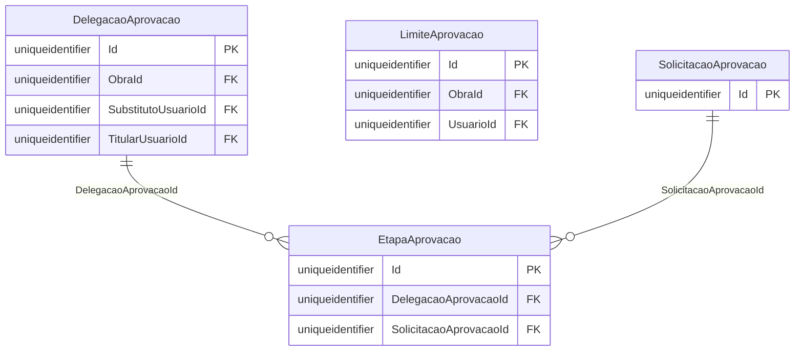

| Tabela | Colunas | Arquivo da classe | Telas que usam |
|---|---|---|---|
| `DelegacoesAprovacao` | 21 | `src/Sigeo.Domain/Aprovacoes/DelegacaoAprovacao.cs` | `(início)`, `engenharia/obras`, `engenharia/tipologias`, `mensagens`, `sistema/parametros`, `sistema/permissoes`, `sistema/usuarios` |
| `EtapasAprovacao` | 13 | `src/Sigeo.Domain/Aprovacoes/EtapaAprovacao.cs` | `engenharia/obras`, `engenharia/tipologias` |
| `LimitesAprovacao` ⏱ | 17 | `src/Sigeo.Domain/Aprovacoes/LimiteAprovacao.cs` | _rotinas internas_ |
| `SolicitacoesAprovacao` ⏱ | 23 | `src/Sigeo.Domain/Aprovacoes/SolicitacaoAprovacao.cs` | `(início)`, `engenharia/obras`, `engenharia/tipologias`, `mensagens`, `requisicoes` |

## Cadastros

```mermaid
erDiagram
    CategoriaProduto {
        uniqueidentifier Id PK
        uniqueidentifier PaiId FK
    }
    CodigoAcessoFornecedor {
        uniqueidentifier Id PK
        uniqueidentifier FornecedorId FK
    }
    Fornecedor {
        uniqueidentifier Id PK
    }
    FornecedorContato {
        uniqueidentifier Id PK
        uniqueidentifier FornecedorId FK
    }
    FornecedorDocumento {
        uniqueidentifier Id PK
        uniqueidentifier FornecedorId FK
        uniqueidentifier TipoDocumentoExigidoId FK
    }
    FornecedorExigencia {
        uniqueidentifier Id PK
        uniqueidentifier FornecedorId FK
        uniqueidentifier TipoDocumentoExigidoId FK
    }
    FornecedorGrupo {
        uniqueidentifier Id PK
        uniqueidentifier CategoriaProdutoId FK
        uniqueidentifier FornecedorId FK
    }
    FornecedorQualificacao {
        uniqueidentifier Id PK
        uniqueidentifier FornecedorId FK
        uniqueidentifier MaterialControladoId FK
        uniqueidentifier ServicoControladoId FK
    }
    FornecedorServico {
        uniqueidentifier Id PK
        uniqueidentifier FornecedorId FK
        uniqueidentifier ServicoControladoId FK
    }
    LinkPortalFornecedor {
        uniqueidentifier Id PK
        uniqueidentifier FornecedorId FK
    }
    Marca {
        uniqueidentifier Id PK
    }
    MaterialControlado {
        uniqueidentifier Id PK
        uniqueidentifier CategoriaProdutoId FK
    }
    Produto {
        uniqueidentifier Id PK
        uniqueidentifier MaterialControladoId FK
        uniqueidentifier SubstituidoPorId FK
    }
    ServicoControlado {
        uniqueidentifier Id PK
        uniqueidentifier DocumentoItsId FK
    }
    TipoDocumentoExigido {
        uniqueidentifier Id PK
    }
    Fornecedor ||--o{ CodigoAcessoFornecedor : "FornecedorId"
    Fornecedor ||--o{ FornecedorContato : "FornecedorId"
    Fornecedor ||--o{ FornecedorDocumento : "FornecedorId"
    TipoDocumentoExigido ||--o{ FornecedorDocumento : "TipoDocumentoExigidoId"
    Fornecedor ||--o{ FornecedorExigencia : "FornecedorId"
    TipoDocumentoExigido ||--o{ FornecedorExigencia : "TipoDocumentoExigidoId"
    CategoriaProduto ||--o{ FornecedorGrupo : "CategoriaProdutoId"
    Fornecedor ||--o{ FornecedorGrupo : "FornecedorId"
    Fornecedor ||--o{ FornecedorQualificacao : "FornecedorId"
    MaterialControlado ||--o{ FornecedorQualificacao : "MaterialControladoId"
    ServicoControlado ||--o{ FornecedorQualificacao : "ServicoControladoId"
    Fornecedor ||--o{ FornecedorServico : "FornecedorId"
    ServicoControlado ||--o{ FornecedorServico : "ServicoControladoId"
    Fornecedor ||--o{ LinkPortalFornecedor : "FornecedorId"
    CategoriaProduto ||--o{ MaterialControlado : "CategoriaProdutoId"
    MaterialControlado ||--o{ Produto : "MaterialControladoId"
```

| Tabela | Colunas | Arquivo da classe | Telas que usam |
|---|---|---|---|
| `CategoriasProduto` | 17 | `src/Sigeo.Domain/Cadastros/CategoriaProduto.cs` | `cadastros/categorias`, `cadastros/controlados`, `cadastros/produtos`, `engenharia/custo-realizado`, `engenharia/importar-erp`, `engenharia/tipologias`, `fornecedores`, `requisicoes` +1 |
| `CodigosAcessoFornecedor` | 13 | `src/Sigeo.Domain/Cadastros/CodigoAcessoFornecedor.cs` | `fornecedor`, `fornecedor/area`, `fornecedor/cotacao/{CotacaoId:guid}` |
| `Fornecedores` ⏱ | 49 | `src/Sigeo.Domain/Cadastros/Fornecedor.cs` | `(início)`, `campo/fvs/{Id:guid}`, `cotacoes`, `cotacoes/mapa`, `engenharia/custo-realizado`, `engenharia/importar-erp`, `engenharia/obras`, `engenharia/tipologias` +35 |
| `FornecedorContatos` | 9 | `src/Sigeo.Domain/Cadastros/FornecedorContato.cs` | `fornecedor`, `fornecedor/area`, `fornecedor/cotacao/{CotacaoId:guid}` |
| `FornecedorDocumentos` ⏱ | 31 | `src/Sigeo.Domain/Cadastros/FornecedorDocumento.cs` | `(início)`, `fornecedores/documentos`, `medicoes`, `suprimentos/documentacao-mensal` |
| `FornecedorExigencias` | 4 | `src/Sigeo.Domain/Cadastros/FornecedorExigencia.cs` | _rotinas internas_ |
| `FornecedorGrupos` | 4 | `src/Sigeo.Domain/Cadastros/FornecedorGrupo.cs` | `fornecedores`, `fornecedores/exigencias` |
| `Qualificacoes` ⏱ | 29 | `src/Sigeo.Domain/Cadastros/FornecedorQualificacao.cs` | `fornecedores/avaliacao`, `fornecedores/qualificacao`, `medicoes` |
| `FornecedorServicos` | 3 | `src/Sigeo.Domain/Cadastros/FornecedorServico.cs` | `fornecedores`, `fornecedores/exigencias` |
| `LinksPortal` | 22 | `src/Sigeo.Domain/Cadastros/LinkPortalFornecedor.cs` | `fornecedor`, `fornecedor/area`, `fornecedor/cotacao/{CotacaoId:guid}` |
| `Marcas` | 14 | `src/Sigeo.Domain/Cadastros/Marca.cs` | `cadastros/categorias`, `cadastros/controlados`, `cadastros/marcas`, `cadastros/produtos`, `cotacoes`, `cotacoes/mapa`, `recebimentos`, `requisicoes` |
| `MateriaisControlados` | 32 | `src/Sigeo.Domain/Cadastros/MaterialControlado.cs` | `(início)`, `cadastros/categorias`, `cadastros/controlados`, `cadastros/produtos`, `engenharia/tipologias`, `fornecedores`, `fornecedores/avaliacao`, `fornecedores/exigencias` +9 |
| `Produtos` | 31 | `src/Sigeo.Domain/Cadastros/Produto.cs` | `(início)`, `cadastros/categorias`, `cadastros/controlados`, `cadastros/produtos`, `cotacoes`, `cotacoes/mapa`, `engenharia/composicoes`, `engenharia/custo-realizado` +24 |
| `ServicosControlados` | 19 | `src/Sigeo.Domain/Cadastros/ServicoControlado.cs` | `cadastros/controlados`, `engenharia/tipologias`, `obra/modelos/{TipoRota}`, `plataforma/auditoria`, `plataforma/construtoras`, `plataforma/usuarios` |
| `TiposDocumento` | 32 | `src/Sigeo.Domain/Cadastros/TipoDocumentoExigido.cs` | `fornecedores`, `fornecedores/exigencias`, `medicoes`, `plataforma/auditoria`, `plataforma/construtoras`, `plataforma/usuarios`, `sistema/parametros`, `suprimentos/documentacao-mensal` |

## Colaboracao

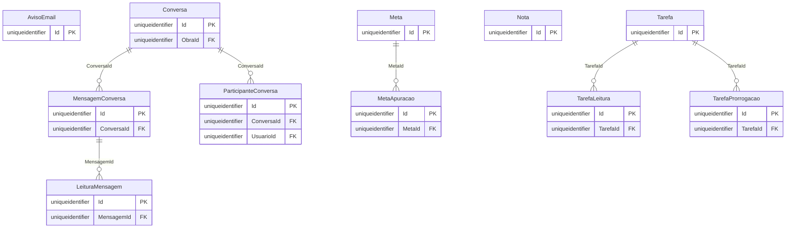

| Tabela | Colunas | Arquivo da classe | Telas que usam |
|---|---|---|---|
| `AvisosEmail` | 23 | `src/Sigeo.Domain/Colaboracao/AvisoEmail.cs` | `(início)`, `mensagens`, `sistema/parametros` |
| `Conversas` ⏱ | 21 | `src/Sigeo.Domain/Colaboracao/Conversa.cs` | `(início)`, `mensagens` |
| `LeiturasMensagem` | 5 | `src/Sigeo.Domain/Colaboracao/LeituraMensagem.cs` | `(início)`, `mensagens` |
| `MensagensConversa` | 6 | `src/Sigeo.Domain/Colaboracao/MensagemConversa.cs` | `(início)`, `mensagens` |
| `Metas` | 29 | `src/Sigeo.Domain/Colaboracao/Meta.cs` | `gestao/metas`, `suprimentos/economia`, `suprimentos/painel`, `suprimentos/precos` |
| `MetasApuracao` | 7 | `src/Sigeo.Domain/Colaboracao/MetaApuracao.cs` | _rotinas internas_ |
| `Notas` | 13 | `src/Sigeo.Domain/Colaboracao/Nota.cs` | `cotacoes`, `cotacoes/mapa`, `engenharia/obras`, `engenharia/tipologias`, `gestao/metas`, `requisicoes`, `suprimentos/compradores`, `suprimentos/fila` +2 |
| `ParticipantesConversa` | 16 | `src/Sigeo.Domain/Colaboracao/ParticipanteConversa.cs` | `(início)`, `mensagens` |
| `Tarefas` ⏱ | 35 | `src/Sigeo.Domain/Colaboracao/Tarefa.cs` | `(início)`, `engenharia/planejamento/imprimir-programacao`, `gestao/metas`, `mensagens`, `tarefas` |
| `TarefaLeituras` | 5 | `src/Sigeo.Domain/Colaboracao/TarefaLeitura.cs` | `gestao/metas`, `tarefas` |
| `TarefaProrrogacoes` | 8 | `src/Sigeo.Domain/Colaboracao/TarefaProrrogacao.cs` | `gestao/metas`, `tarefas` |

## Common

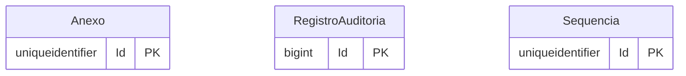

| Tabela | Colunas | Arquivo da classe | Telas que usam |
|---|---|---|---|
| `Anexos` | 18 | `src/Sigeo.Domain/Common/Anexo.cs` | `campo/fvs/{Id:guid}`, `campo/local/{Qr}`, `engenharia/diario/imprimir`, `engenharia/obras`, `obra/acoes`, `obra/auditorias`, `obra/equipamentos`, `obra/fvs` +5 |
| `Auditoria` | 13 | `src/Sigeo.Domain/Common/RegistroAuditoria.cs` | `recebimentos`, `sistema/log` |
| `Sequencias` | 5 | `src/Sigeo.Domain/Common/Sequencia.cs` | `(início)`, `cadastros/categorias`, `cadastros/controlados`, `cadastros/produtos`, `campo/fvs/{Id:guid}`, `campo/local/{Qr}`, `contratos`, `cotacoes` +48 |

## Documentos

| Tabela | Colunas | Arquivo da classe | Telas que usam |
|---|---|---|---|
| `Checkouts` | 17 | `src/Sigeo.Domain/Documentos/CheckoutDocumento.cs` | `sgq/documentos` |
| `Ciencias` | 17 | `src/Sigeo.Domain/Documentos/Ciencia.cs` | `(início)`, `mensagens`, `sgq/documentos`, `sgq/leituras` |
| `Copias` ⏱ | 27 | `src/Sigeo.Domain/Documentos/CopiaControlada.cs` | `(início)`, `qr/{Token}`, `sgq/copias`, `sgq/documentos` |
| `Documentos` ⏱ | 34 | `src/Sigeo.Domain/Documentos/Documento.cs` | `(início)`, `campo/fvs/{Id:guid}`, `campo/local/{Qr}`, `engenharia/obras`, `obra/acoes`, `obra/auditorias`, `obra/equipamentos`, `obra/fvs` +8 |
| `DocumentosExternos` ⏱ | 21 | `src/Sigeo.Domain/Documentos/DocumentoExterno.cs` | `sgq/externos` |
| `DocumentosRelacionados` | 3 | `src/Sigeo.Domain/Documentos/DocumentoRelacionado.cs` | _rotinas internas_ |
| `Revisoes` ⏱ | 34 | `src/Sigeo.Domain/Documentos/DocumentoRevisao.cs` | `qr/{Token}`, `sgq/copias`, `sgq/grd` |
| `EtapasRevisao` | 11 | `src/Sigeo.Domain/Documentos/EtapaRevisao.cs` | _rotinas internas_ |
| `EventosDocumento` | 12 | `src/Sigeo.Domain/Documentos/EventoDocumento.cs` | `(início)`, `sgq/documentos`, `sistema/log`, `sistema/parametros`, `sistema/permissoes`, `sistema/usuarios` |
| `Grds` | 19 | `src/Sigeo.Domain/Documentos/Grd.cs` | `(início)`, `sgq/grd` |
| `GrdItens` | 3 | `src/Sigeo.Domain/Documentos/GrdItem.cs` | _rotinas internas_ |
| `Pastas` | 13 | `src/Sigeo.Domain/Documentos/Pasta.cs` | `plataforma/auditoria`, `plataforma/construtoras`, `plataforma/usuarios`, `sgq/documentos`, `sgq/lista-mestra`, `sistema/permissoes` |
| `Permissoes` ⏱ | 23 | `src/Sigeo.Domain/Documentos/PermissaoDocumento.cs` | `(início)`, `sistema/parametros`, `sistema/permissoes`, `sistema/usuarios` |
| `RegrasRetencao` | 18 | `src/Sigeo.Domain/Documentos/RegraRetencao.cs` | `plataforma/auditoria`, `plataforma/construtoras`, `plataforma/usuarios`, `sgq/documentos`, `sgq/registros` |
| `SolicitacoesCopia` | 21 | `src/Sigeo.Domain/Documentos/SolicitacaoCopia.cs` | `sgq/copias` |
| `SolicitacaoCopiaItens` | 5 | `src/Sigeo.Domain/Documentos/SolicitacaoCopiaItem.cs` | _rotinas internas_ |

## Engenharia

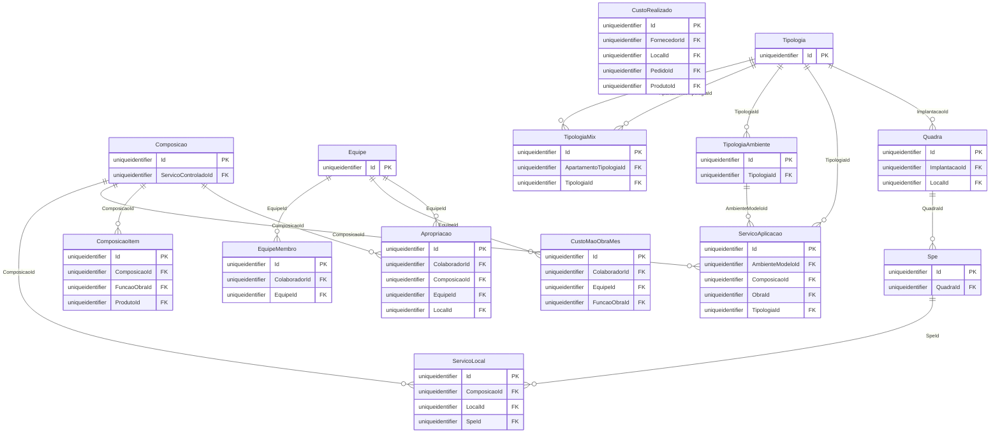

| Tabela | Colunas | Arquivo da classe | Telas que usam |
|---|---|---|---|
| `Apropriacoes` | 20 | `src/Sigeo.Domain/Engenharia/Apropriacao.cs` | `engenharia/mao-de-obra`, `engenharia/obras`, `engenharia/tipologias`, `medicoes`, `suprimentos/documentacao-mensal` |
| `Composicoes` ⏱ | 22 | `src/Sigeo.Domain/Engenharia/Composicao.cs` | `engenharia/composicoes`, `engenharia/cronograma`, `engenharia/custo-realizado`, `engenharia/importar-erp`, `engenharia/mao-de-obra`, `engenharia/planejamento`, `engenharia/planejamento/imprimir`, `engenharia/planejamento/imprimir-programacao` +7 |
| `ComposicaoItens` | 11 | `src/Sigeo.Domain/Engenharia/ComposicaoItem.cs` | `cadastros/produtos` |
| `CustosMaoObra` | 22 | `src/Sigeo.Domain/Engenharia/CustoMaoObraMes.cs` | `engenharia/mao-de-obra` |
| `CustosRealizados` | 32 | `src/Sigeo.Domain/Engenharia/CustoRealizado.cs` | `cadastros/produtos`, `engenharia/custo-realizado`, `engenharia/importar-erp` |
| `Equipes` | 15 | `src/Sigeo.Domain/Engenharia/Equipe.cs` | `engenharia/mao-de-obra`, `gestao/metas` |
| `EquipeMembros` | 5 | `src/Sigeo.Domain/Engenharia/EquipeMembro.cs` | _rotinas internas_ |
| `Quadras` ⏱ | 26 | `src/Sigeo.Domain/Engenharia/Quadra.cs` | `engenharia/obras`, `engenharia/tipologias` |
| `ServicoAplicacoes` | 16 | `src/Sigeo.Domain/Engenharia/ServicoAplicacao.cs` | `engenharia/composicoes`, `engenharia/obras`, `engenharia/tipologias`, `requisicoes` |
| `ServicosLocais` | 19 | `src/Sigeo.Domain/Engenharia/ServicoLocal.cs` | `engenharia/composicoes`, `engenharia/cronograma`, `engenharia/custo-realizado`, `engenharia/importar-erp`, `engenharia/mao-de-obra`, `engenharia/obras`, `engenharia/planejamento`, `engenharia/planejamento/imprimir` +9 |
| `Spes` ⏱ | 24 | `src/Sigeo.Domain/Engenharia/Spe.cs` | `engenharia/diario`, `engenharia/obras`, `engenharia/planejamento/imprimir-programacao`, `engenharia/tipologias`, `equipamentos`, `estoque`, `estoque/kits`, `notas-fiscais` +3 |
| `Tipologias` | 24 | `src/Sigeo.Domain/Engenharia/Tipologia.cs` | `engenharia/composicoes`, `engenharia/importar-erp`, `engenharia/obras`, `engenharia/tipologias`, `financeiro/bancos`, `financeiro/cadastros`, `financeiro/fluxo`, `financeiro/pagar` +6 |
| `TipologiaAmbientes` | 13 | `src/Sigeo.Domain/Engenharia/TipologiaAmbiente.cs` | `engenharia/obras`, `engenharia/tipologias` |
| `TipologiaMix` | 7 | `src/Sigeo.Domain/Engenharia/TipologiaMix.cs` | _rotinas internas_ |

## Estrutura

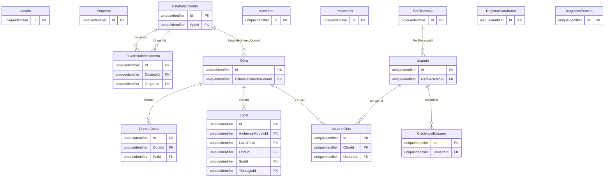

| Tabela | Colunas | Arquivo da classe | Telas que usam |
|---|---|---|---|
| `Alcadas` | 24 | `src/Sigeo.Domain/Estrutura/Alcada.cs` | `(início)`, `engenharia/obras`, `engenharia/tipologias`, `mensagens`, `plataforma/auditoria`, `plataforma/construtoras`, `plataforma/usuarios`, `sistema/usuarios` |
| `CentrosCusto` | 18 | `src/Sigeo.Domain/Estrutura/CentroCusto.cs` | `cadastros/centros-custo`, `cadastros/estabelecimentos`, `requisicoes` |
| `CredenciaisUsuario` | 17 | `src/Sigeo.Domain/Estrutura/CredencialUsuario.cs` | `conta/construtora`, `plataforma/auditoria`, `plataforma/construtoras`, `plataforma/usuarios`, `sistema/usuarios` |
| `Empresas` | 12 | `src/Sigeo.Domain/Estrutura/Empresa.cs` | `(início)`, `conta/construtora`, `engenharia/cronograma`, `engenharia/diario`, `engenharia/importar-erp`, `engenharia/obras`, `engenharia/planejamento`, `engenharia/planejamento/imprimir` +22 |
| `Estabelecimentos` | 26 | `src/Sigeo.Domain/Estrutura/Estabelecimento.cs` | `cadastros/centros-custo`, `cadastros/estabelecimentos`, `campo/fvs/{Id:guid}`, `campo/local/{Qr}`, `cotacoes`, `cotacoes/mapa`, `engenharia/obras`, `equipamentos` +20 |
| `FluxosEstabelecimento` | 16 | `src/Sigeo.Domain/Estrutura/FluxoEstabelecimento.cs` | `cadastros/centros-custo`, `cadastros/estabelecimentos`, `requisicoes` |
| `Listas` | 15 | `src/Sigeo.Domain/Estrutura/ItemLista.cs` | `plataforma/auditoria`, `plataforma/construtoras`, `plataforma/usuarios`, `sistema/parametros` |
| `Locais` | 29 | `src/Sigeo.Domain/Estrutura/Local.cs` | `campo/fvs/{Id:guid}`, `campo/local/{Qr}`, `contratos`, `cotacoes`, `cotacoes/mapa`, `engenharia/composicoes`, `engenharia/cronograma`, `engenharia/custo-realizado` +40 |
| `Obras` | 30 | `src/Sigeo.Domain/Estrutura/Obra.cs` | `(início)`, `cadastros/produtos`, `campo/fvs/{Id:guid}`, `campo/local/{Qr}`, `contratos`, `cotacoes`, `cotacoes/mapa`, `engenharia/cronograma` +55 |
| `Parametros` ⏱ | 17 | `src/Sigeo.Domain/Estrutura/Parametro.cs` | `(início)`, `campo/fvs/{Id:guid}`, `campo/local/{Qr}`, `contratos`, `cotacoes`, `cotacoes/mapa`, `engenharia/obras`, `fornecedores` +30 |
| `PerfisAcesso` | 14 | `src/Sigeo.Domain/Estrutura/PerfilAcesso.cs` | `(início)`, `engenharia/cronograma`, `engenharia/diario`, `engenharia/obras`, `engenharia/planejamento`, `engenharia/planejamento/imprimir`, `engenharia/planejamento/imprimir-programacao`, `engenharia/tipologias` +7 |
| `RegistrosPlataforma` | 7 | `src/Sigeo.Domain/Estrutura/RegistroPlataforma.cs` | `plataforma/auditoria`, `plataforma/construtoras`, `plataforma/usuarios` |
| `RegrasNotificacao` | 17 | `src/Sigeo.Domain/Estrutura/RegraNotificacao.cs` | `(início)`, `mensagens`, `plataforma/auditoria`, `plataforma/construtoras`, `plataforma/usuarios`, `sistema/parametros` |
| `Usuarios` | 22 | `src/Sigeo.Domain/Estrutura/Usuario.cs` | `(início)`, `campo/fvs/{Id:guid}`, `campo/local/{Qr}`, `conta/construtora`, `cotacoes`, `cotacoes/mapa`, `engenharia/cronograma`, `engenharia/diario` +31 |
| `UsuariosObras` | 3 | `src/Sigeo.Domain/Estrutura/UsuarioObra.cs` | `(início)`, `sistema/parametros`, `sistema/permissoes`, `sistema/usuarios` |

## Financeiro

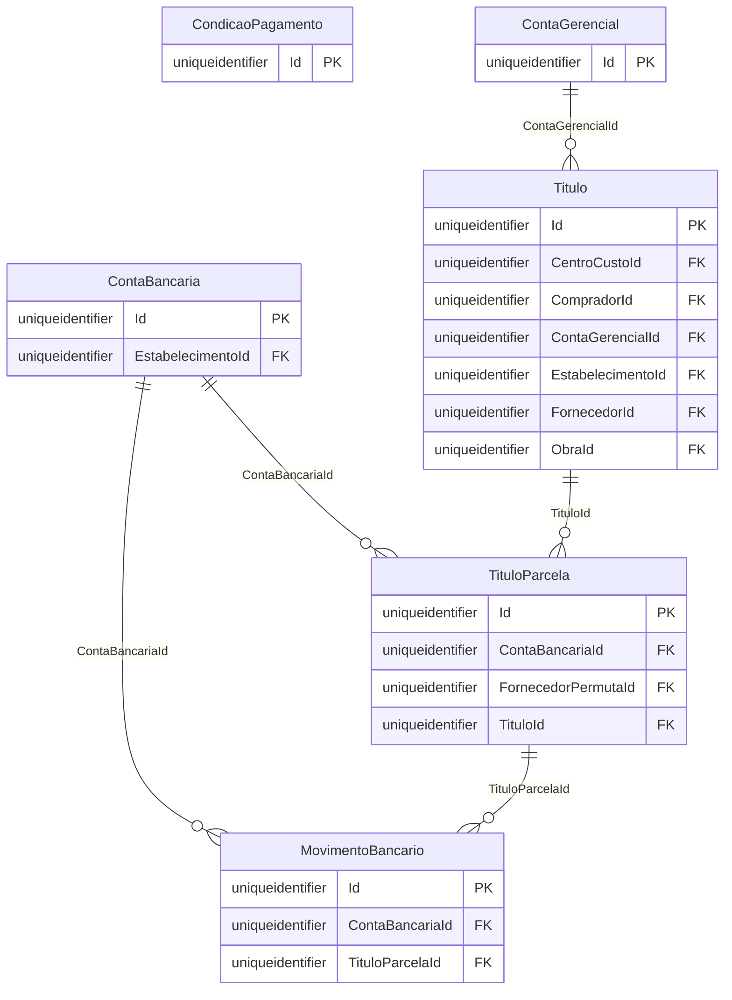

| Tabela | Colunas | Arquivo da classe | Telas que usam |
|---|---|---|---|
| `CondicoesPagamento` | 14 | `src/Sigeo.Domain/Financeiro/CondicaoPagamento.cs` | `engenharia/importar-erp`, `financeiro/bancos`, `financeiro/cadastros`, `financeiro/fluxo`, `financeiro/pagar`, `incorporacao/carteira`, `incorporacao/vendas`, `plataforma/auditoria` +2 |
| `ContasBancarias` | 19 | `src/Sigeo.Domain/Financeiro/ContaBancaria.cs` | `engenharia/importar-erp`, `financeiro/bancos`, `financeiro/cadastros`, `financeiro/fluxo`, `financeiro/pagar`, `incorporacao/carteira`, `incorporacao/vendas` |
| `ContasGerenciais` | 14 | `src/Sigeo.Domain/Financeiro/ContaGerencial.cs` | `engenharia/importar-erp`, `financeiro/bancos`, `financeiro/cadastros`, `financeiro/fluxo`, `financeiro/pagar`, `incorporacao/carteira`, `incorporacao/empreendimento`, `incorporacao/espelho` +5 |
| `MovimentosBancarios` | 19 | `src/Sigeo.Domain/Financeiro/MovimentoBancario.cs` | `engenharia/importar-erp`, `financeiro/bancos`, `financeiro/cadastros`, `financeiro/fluxo`, `financeiro/pagar`, `incorporacao/carteira`, `incorporacao/vendas` |
| `Titulos` ⏱ | 38 | `src/Sigeo.Domain/Financeiro/Titulo.cs` | `engenharia/importar-erp`, `financeiro/bancos`, `financeiro/cadastros`, `financeiro/fluxo`, `financeiro/pagar`, `incorporacao/carteira`, `incorporacao/empreendimento`, `incorporacao/espelho` +2 |
| `TituloParcelas` ⏱ | 28 | `src/Sigeo.Domain/Financeiro/TituloParcela.cs` | `engenharia/importar-erp`, `financeiro/bancos`, `financeiro/cadastros`, `financeiro/fluxo`, `financeiro/pagar`, `incorporacao/carteira`, `incorporacao/empreendimento`, `incorporacao/espelho` +2 |

## Fiscal

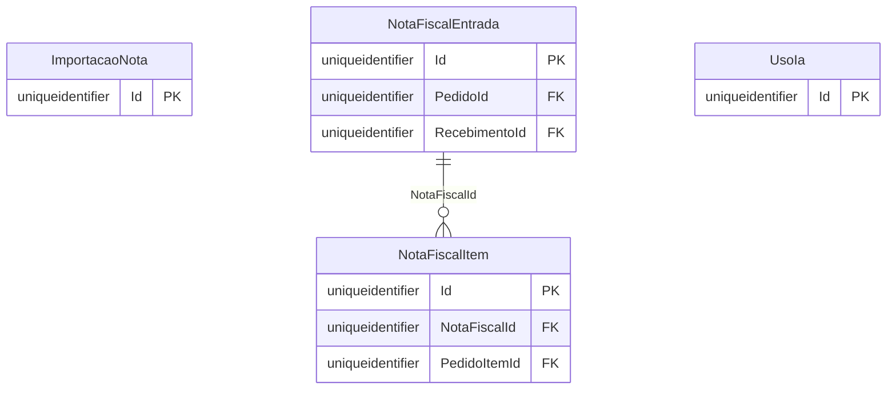

| Tabela | Colunas | Arquivo da classe | Telas que usam |
|---|---|---|---|
| `ImportacoesNota` | 19 | `src/Sigeo.Domain/Fiscal/ImportacaoNota.cs` | `notas-fiscais` |
| `NotasFiscais` | 33 | `src/Sigeo.Domain/Fiscal/NotaFiscalEntrada.cs` | `cadastros/produtos`, `contratos/parcelas`, `notas-fiscais`, `obra/rnc`, `recebimentos` |
| `NotaFiscalItens` | 16 | `src/Sigeo.Domain/Fiscal/NotaFiscalItem.cs` | _rotinas internas_ |
| `UsosIa` | 16 | `src/Sigeo.Domain/Fiscal/UsoIa.cs` | `cadastros/produtos`, `obra/rnc` |

## Importacao

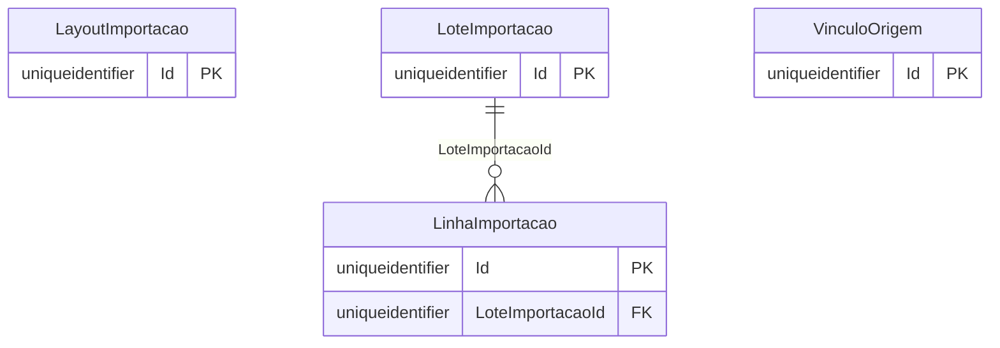

| Tabela | Colunas | Arquivo da classe | Telas que usam |
|---|---|---|---|
| `LayoutsImportacao` | 17 | `src/Sigeo.Domain/Importacao/LayoutImportacao.cs` | _rotinas internas_ |
| `LinhasImportacao` | 8 | `src/Sigeo.Domain/Importacao/LinhaImportacao.cs` | _rotinas internas_ |
| `LotesImportacao` | 24 | `src/Sigeo.Domain/Importacao/LoteImportacao.cs` | _rotinas internas_ |
| `VinculosOrigem` | 18 | `src/Sigeo.Domain/Importacao/VinculoOrigem.cs` | `cadastros/produtos` |

## Incorporacao

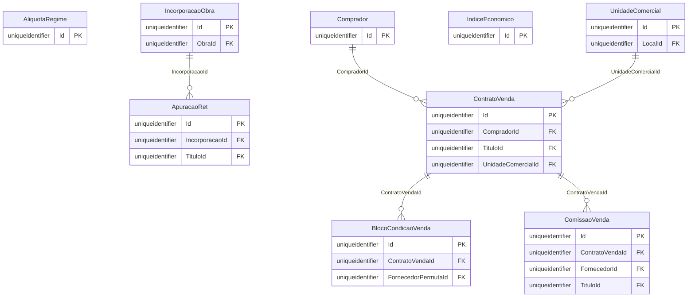

| Tabela | Colunas | Arquivo da classe | Telas que usam |
|---|---|---|---|
| `AliquotasRegime` | 20 | `src/Sigeo.Domain/Incorporacao/AliquotaRegime.cs` | `engenharia/importar-erp`, `financeiro/bancos`, `financeiro/cadastros`, `financeiro/fluxo`, `financeiro/pagar`, `incorporacao/carteira`, `incorporacao/empreendimento`, `incorporacao/espelho` +5 |
| `ApuracoesRet` | 23 | `src/Sigeo.Domain/Incorporacao/ApuracaoRet.cs` | `engenharia/importar-erp`, `financeiro/bancos`, `financeiro/cadastros`, `financeiro/fluxo`, `financeiro/pagar`, `incorporacao/carteira`, `incorporacao/empreendimento`, `incorporacao/espelho` +2 |
| `BlocosCondicaoVenda` | 8 | `src/Sigeo.Domain/Incorporacao/BlocoCondicaoVenda.cs` | _rotinas internas_ |
| `ComissoesVenda` | 11 | `src/Sigeo.Domain/Incorporacao/ComissaoVenda.cs` | _rotinas internas_ |
| `Compradores` | 17 | `src/Sigeo.Domain/Incorporacao/Comprador.cs` | `engenharia/importar-erp`, `financeiro/bancos`, `financeiro/cadastros`, `financeiro/fluxo`, `financeiro/pagar`, `incorporacao/carteira`, `incorporacao/empreendimento`, `incorporacao/espelho` +2 |
| `ContratosVenda` | 26 | `src/Sigeo.Domain/Incorporacao/ContratoVenda.cs` | `engenharia/importar-erp`, `financeiro/bancos`, `financeiro/cadastros`, `financeiro/fluxo`, `financeiro/pagar`, `incorporacao/carteira`, `incorporacao/empreendimento`, `incorporacao/espelho` +2 |
| `Incorporacoes` | 26 | `src/Sigeo.Domain/Incorporacao/IncorporacaoObra.cs` | `engenharia/importar-erp`, `financeiro/bancos`, `financeiro/cadastros`, `financeiro/fluxo`, `financeiro/pagar`, `incorporacao/carteira`, `incorporacao/empreendimento`, `incorporacao/espelho` +2 |
| `IndicesEconomicos` | 13 | `src/Sigeo.Domain/Incorporacao/IndiceEconomico.cs` | `engenharia/importar-erp`, `financeiro/bancos`, `financeiro/cadastros`, `financeiro/fluxo`, `financeiro/pagar`, `incorporacao/carteira`, `incorporacao/empreendimento`, `incorporacao/espelho` +2 |
| `UnidadesComerciais` | 16 | `src/Sigeo.Domain/Incorporacao/UnidadeComercial.cs` | `engenharia/importar-erp`, `financeiro/bancos`, `financeiro/cadastros`, `financeiro/fluxo`, `financeiro/pagar`, `incorporacao/carteira`, `incorporacao/empreendimento`, `incorporacao/espelho` +2 |

## Planejamento

```mermaid
erDiagram
    AtividadeCronograma {
        uniqueidentifier Id PK
        uniqueidentifier ComposicaoId FK
        uniqueidentifier LocalId FK
        uniqueidentifier PaiId FK
        uniqueidentifier VersaoId FK
    }
    CompromissoSemanal {
        uniqueidentifier Id PK
        uniqueidentifier PlanoId FK
    }
    DesembolsoVersao {
        uniqueidentifier Id PK
        uniqueidentifier VersaoId FK
    }
    DiarioAtividade {
        uniqueidentifier Id PK
        uniqueidentifier DiarioId FK
        uniqueidentifier LocalId FK
    }
    DiarioEfetivo {
        uniqueidentifier Id PK
        uniqueidentifier DiarioId FK
    }
    DiarioEquipamento {
        uniqueidentifier Id PK
        uniqueidentifier DiarioId FK
        uniqueidentifier EquipamentoId FK
    }
    DiarioObra {
        uniqueidentifier Id PK
        uniqueidentifier ObraId FK
    }
    Feriado {
        uniqueidentifier Id PK
        uniqueidentifier ObraId FK
    }
    MedicaoSemanal {
        uniqueidentifier Id PK
        uniqueidentifier LocalId FK
        uniqueidentifier ObraId FK
    }
    PlanoSemanal {
        uniqueidentifier Id PK
        uniqueidentifier ObraId FK
    }
    RedeLocal {
        uniqueidentifier Id PK
        uniqueidentifier LocalId FK
        uniqueidentifier RedeId FK
    }
    RedePacote {
        uniqueidentifier Id PK
        uniqueidentifier ComposicaoId FK
        uniqueidentifier RedeId FK
    }
    RedePacoteLocal {
        uniqueidentifier Id PK
        uniqueidentifier LocalId FK
        uniqueidentifier PacoteId FK
    }
    RedePlanejamento {
        uniqueidentifier Id PK
        uniqueidentifier ObraId FK
    }
    Restricao {
        uniqueidentifier Id PK
        uniqueidentifier ObraId FK
        uniqueidentifier ResponsavelId FK
    }
    VersaoCronograma {
        uniqueidentifier Id PK
        uniqueidentifier ObraId FK
    }
    VinculoAtividade {
        uniqueidentifier Id PK
        uniqueidentifier PredecessoraId FK
        uniqueidentifier SucessoraId FK
        uniqueidentifier VersaoId FK
    }
    VinculoRede {
        uniqueidentifier Id PK
        uniqueidentifier ObraId FK
        uniqueidentifier PacoteDestinoId FK
        uniqueidentifier PacoteOrigemId FK
    }
    VersaoCronograma ||--o{ AtividadeCronograma : "VersaoId"
    PlanoSemanal ||--o{ CompromissoSemanal : "PlanoId"
    VersaoCronograma ||--o{ DesembolsoVersao : "VersaoId"
    DiarioObra ||--o{ DiarioAtividade : "DiarioId"
    DiarioObra ||--o{ DiarioEfetivo : "DiarioId"
    DiarioObra ||--o{ DiarioEquipamento : "DiarioId"
    RedePlanejamento ||--o{ RedeLocal : "RedeId"
    RedePlanejamento ||--o{ RedePacote : "RedeId"
    RedePacote ||--o{ RedePacoteLocal : "PacoteId"
    AtividadeCronograma ||--o{ VinculoAtividade : "PredecessoraId"
    AtividadeCronograma ||--o{ VinculoAtividade : "SucessoraId"
    VersaoCronograma ||--o{ VinculoAtividade : "VersaoId"
    RedePacote ||--o{ VinculoRede : "PacoteDestinoId"
    RedePacote ||--o{ VinculoRede : "PacoteOrigemId"
```

| Tabela | Colunas | Arquivo da classe | Telas que usam |
|---|---|---|---|
| `AtividadesCronograma` | 22 | `src/Sigeo.Domain/Planejamento/AtividadeCronograma.cs` | `engenharia/cronograma`, `engenharia/obras`, `engenharia/planejamento`, `engenharia/planejamento/imprimir`, `engenharia/planejamento/imprimir-programacao`, `engenharia/tipologias` |
| `CompromissosSemanais` | 11 | `src/Sigeo.Domain/Planejamento/CompromissoSemanal.cs` | _rotinas internas_ |
| `DesembolsoVersao` | 5 | `src/Sigeo.Domain/Planejamento/DesembolsoVersao.cs` | `engenharia/cronograma`, `engenharia/planejamento`, `engenharia/planejamento/imprimir`, `engenharia/planejamento/imprimir-programacao` |
| `DiariosObraAtividades` | 6 | `src/Sigeo.Domain/Planejamento/DiarioAtividade.cs` | `engenharia/diario` |
| `DiariosObraEfetivo` | 7 | `src/Sigeo.Domain/Planejamento/DiarioEfetivo.cs` | _rotinas internas_ |
| `DiariosObraEquipamentos` | 6 | `src/Sigeo.Domain/Planejamento/DiarioEquipamento.cs` | _rotinas internas_ |
| `DiariosObra` ⏱ | 29 | `src/Sigeo.Domain/Planejamento/DiarioObra.cs` | `engenharia/diario`, `engenharia/diario/imprimir`, `engenharia/planejamento/imprimir-programacao` |
| `Feriados` | 13 | `src/Sigeo.Domain/Planejamento/Feriado.cs` | `engenharia/cronograma`, `engenharia/planejamento`, `engenharia/planejamento/imprimir`, `engenharia/planejamento/imprimir-programacao` |
| `MedicoesSemanais` ⏱ | 25 | `src/Sigeo.Domain/Planejamento/MedicaoSemanal.cs` | `engenharia/planejamento/imprimir-programacao` |
| `PlanosSemanais` ⏱ | 19 | `src/Sigeo.Domain/Planejamento/PlanoSemanal.cs` | `engenharia/diario`, `engenharia/planejamento/imprimir-programacao`, `estoque/kits`, `gestao/metas` |
| `RedeLocais` | 4 | `src/Sigeo.Domain/Planejamento/RedeLocal.cs` | `engenharia/cronograma`, `engenharia/obras`, `engenharia/planejamento`, `engenharia/planejamento/imprimir`, `engenharia/planejamento/imprimir-programacao`, `engenharia/tipologias` |
| `RedePacotes` | 7 | `src/Sigeo.Domain/Planejamento/RedePacote.cs` | `engenharia/cronograma`, `engenharia/planejamento`, `engenharia/planejamento/imprimir`, `engenharia/planejamento/imprimir-programacao` |
| `RedePacoteLocais` | 4 | `src/Sigeo.Domain/Planejamento/RedePacoteLocal.cs` | `engenharia/cronograma`, `engenharia/obras`, `engenharia/planejamento`, `engenharia/planejamento/imprimir`, `engenharia/planejamento/imprimir-programacao`, `engenharia/tipologias` |
| `RedesPlanejamento` | 16 | `src/Sigeo.Domain/Planejamento/RedePlanejamento.cs` | `engenharia/cronograma`, `engenharia/planejamento`, `engenharia/planejamento/imprimir`, `engenharia/planejamento/imprimir-programacao` |
| `Restricoes` ⏱ | 27 | `src/Sigeo.Domain/Planejamento/Restricao.cs` | `(início)`, `campo/fvs/{Id:guid}`, `campo/local/{Qr}`, `engenharia/diario`, `engenharia/obras`, `engenharia/planejamento/imprimir-programacao`, `equipamentos`, `estoque` +19 |
| `VersoesCronograma` ⏱ | 28 | `src/Sigeo.Domain/Planejamento/VersaoCronograma.cs` | `(início)`, `engenharia/cronograma`, `engenharia/last-planner`, `engenharia/planejamento`, `engenharia/planejamento/imprimir`, `engenharia/planejamento/imprimir-programacao`, `mensagens` |
| `VinculosAtividade` | 6 | `src/Sigeo.Domain/Planejamento/VinculoAtividade.cs` | `engenharia/cronograma`, `engenharia/planejamento`, `engenharia/planejamento/imprimir`, `engenharia/planejamento/imprimir-programacao` |
| `VinculosRede` | 7 | `src/Sigeo.Domain/Planejamento/VinculoRede.cs` | `engenharia/cronograma`, `engenharia/planejamento`, `engenharia/planejamento/imprimir`, `engenharia/planejamento/imprimir-programacao` |

## Qualidade

```mermaid
erDiagram
    AcaoCorretiva {
        uniqueidentifier Id PK
    }
    AcaoCorretivaItem {
        uniqueidentifier Id PK
        uniqueidentifier AcaoCorretivaId FK
    }
    AplicacaoLote {
        uniqueidentifier Id PK
        uniqueidentifier RecebimentoId FK
    }
    AuditoriaInterna {
        uniqueidentifier Id PK
    }
    Calibracao {
        uniqueidentifier Id PK
        uniqueidentifier EquipamentoMedicaoId FK
    }
    CautelaFerramenta {
        uniqueidentifier Id PK
        uniqueidentifier ColaboradorId FK
        uniqueidentifier EquipamentoMedicaoId FK
        uniqueidentifier FornecedorId FK
    }
    Constatacao {
        uniqueidentifier Id PK
        uniqueidentifier AuditoriaInternaId FK
    }
    EnsaioModelo {
        uniqueidentifier Id PK
        uniqueidentifier ModeloInspecaoId FK
    }
    EnsaioRecebimento {
        uniqueidentifier Id PK
        uniqueidentifier RecebimentoId FK
    }
    EquipamentoMedicao {
        uniqueidentifier Id PK
        uniqueidentifier CautelaColaboradorId FK
        uniqueidentifier CautelaFornecedorId FK
        uniqueidentifier FornecedorId FK
        uniqueidentifier TipoMedicaoId FK
    }
    FvmItem {
        uniqueidentifier Id PK
        uniqueidentifier RecebimentoId FK
    }
    Fvs {
        uniqueidentifier Id PK
        uniqueidentifier LocalId FK
        uniqueidentifier ModeloInspecaoId FK
    }
    FvsItem {
        uniqueidentifier Id PK
        uniqueidentifier FvsId FK
    }
    ItemVerificacao {
        uniqueidentifier Id PK
        uniqueidentifier ModeloInspecaoId FK
    }
    ModeloInspecao {
        uniqueidentifier Id PK
    }
    Rnc {
        uniqueidentifier Id PK
    }
    TipoEquipamentoMedicao {
        uniqueidentifier Id PK
    }
    AcaoCorretiva ||--o{ AcaoCorretivaItem : "AcaoCorretivaId"
    EquipamentoMedicao ||--o{ Calibracao : "EquipamentoMedicaoId"
    EquipamentoMedicao ||--o{ CautelaFerramenta : "EquipamentoMedicaoId"
    AuditoriaInterna ||--o{ Constatacao : "AuditoriaInternaId"
    ModeloInspecao ||--o{ EnsaioModelo : "ModeloInspecaoId"
    TipoEquipamentoMedicao ||--o{ EquipamentoMedicao : "TipoMedicaoId"
    ModeloInspecao ||--o{ Fvs : "ModeloInspecaoId"
    Fvs ||--o{ FvsItem : "FvsId"
    ModeloInspecao ||--o{ ItemVerificacao : "ModeloInspecaoId"
```

| Tabela | Colunas | Arquivo da classe | Telas que usam |
|---|---|---|---|
| `AcoesCorretivas` ⏱ | 27 | `src/Sigeo.Domain/Qualidade/AcaoCorretiva.cs` | `(início)`, `campo/fvs/{Id:guid}`, `campo/local/{Qr}`, `engenharia/obras`, `mensagens`, `obra/acoes`, `obra/auditorias`, `obra/equipamentos` +5 |
| `AcaoCorretivaItens` | 8 | `src/Sigeo.Domain/Qualidade/AcaoCorretivaItem.cs` | _rotinas internas_ |
| `AplicacoesLote` | 8 | `src/Sigeo.Domain/Qualidade/AplicacaoLote.cs` | `campo/fvs/{Id:guid}`, `campo/local/{Qr}`, `engenharia/obras`, `engenharia/tipologias`, `obra/acoes`, `obra/auditorias`, `obra/equipamentos`, `obra/fvs` +4 |
| `AuditoriasInternas` ⏱ | 21 | `src/Sigeo.Domain/Qualidade/AuditoriaInterna.cs` | `(início)`, `campo/fvs/{Id:guid}`, `campo/local/{Qr}`, `engenharia/obras`, `mensagens`, `obra/acoes`, `obra/auditorias`, `obra/equipamentos` +5 |
| `Calibracoes` | 11 | `src/Sigeo.Domain/Qualidade/Calibracao.cs` | `campo/fvs/{Id:guid}`, `campo/local/{Qr}`, `engenharia/obras`, `obra/acoes`, `obra/auditorias`, `obra/equipamentos`, `obra/fvs`, `obra/modelos/{TipoRota}` +3 |
| `CautelasFerramenta` | 18 | `src/Sigeo.Domain/Qualidade/CautelaFerramenta.cs` | `campo/fvs/{Id:guid}`, `campo/local/{Qr}`, `engenharia/obras`, `obra/acoes`, `obra/auditorias`, `obra/equipamentos`, `obra/fvs`, `obra/modelos/{TipoRota}` +3 |
| `Constatacoes` | 8 | `src/Sigeo.Domain/Qualidade/Constatacao.cs` | _rotinas internas_ |
| `EnsaiosModelo` | 10 | `src/Sigeo.Domain/Qualidade/EnsaioModelo.cs` | _rotinas internas_ |
| `EnsaiosRecebimento` ⏱ | 24 | `src/Sigeo.Domain/Qualidade/EnsaioRecebimento.cs` | `(início)`, `campo/fvs/{Id:guid}`, `campo/local/{Qr}`, `engenharia/obras`, `obra/acoes`, `obra/auditorias`, `obra/equipamentos`, `obra/fvs` +4 |
| `Equipamentos` ⏱ | 34 | `src/Sigeo.Domain/Qualidade/EquipamentoMedicao.cs` | `(início)`, `campo/fvs/{Id:guid}`, `campo/local/{Qr}`, `engenharia/obras`, `obra/acoes`, `obra/auditorias`, `obra/equipamentos`, `obra/equipamentos/etiquetas` +6 |
| `FvmItens` | 13 | `src/Sigeo.Domain/Qualidade/FvmItem.cs` | `obra/modelos/{TipoRota}` |
| `Fvs` ⏱ | 34 | `src/Sigeo.Domain/Qualidade/Fvs.cs` | `(início)`, `campo/fvs/{Id:guid}`, `campo/local/{Qr}`, `engenharia/obras`, `engenharia/planejamento/imprimir-programacao`, `engenharia/tipologias`, `medicoes`, `mensagens` +9 |
| `FvsItens` | 16 | `src/Sigeo.Domain/Qualidade/FvsItem.cs` | `obra/modelos/{TipoRota}` |
| `ItensVerificacao` | 12 | `src/Sigeo.Domain/Qualidade/ItemVerificacao.cs` | _rotinas internas_ |
| `ModelosInspecao` ⏱ | 30 | `src/Sigeo.Domain/Qualidade/ModeloInspecao.cs` | `cadastros/controlados`, `campo/fvs/{Id:guid}`, `campo/local/{Qr}`, `engenharia/obras`, `obra/acoes`, `obra/auditorias`, `obra/equipamentos`, `obra/fvs` +14 |
| `Rncs` ⏱ | 33 | `src/Sigeo.Domain/Qualidade/Rnc.cs` | `(início)`, `campo/fvs/{Id:guid}`, `campo/local/{Qr}`, `engenharia/obras`, `engenharia/tipologias`, `fornecedores/avaliacao`, `fornecedores/qualificacao`, `medicoes` +16 |
| `TiposEquipamentoMedicao` | 17 | `src/Sigeo.Domain/Qualidade/TipoEquipamentoMedicao.cs` | `campo/fvs/{Id:guid}`, `campo/local/{Qr}`, `engenharia/obras`, `obra/acoes`, `obra/auditorias`, `obra/equipamentos`, `obra/fvs`, `obra/modelos/{TipoRota}` +6 |

## Sst

```mermaid
erDiagram
    Colaborador {
        uniqueidentifier Id PK
    }
    DocumentoColaborador {
        uniqueidentifier Id PK
    }
    EntregaEpi {
        uniqueidentifier Id PK
    }
    Epi {
        uniqueidentifier Id PK
    }
    ExecutantePt {
        uniqueidentifier Id PK
        uniqueidentifier PermissaoTrabalhoId FK
    }
    Exigencia {
        uniqueidentifier Id PK
    }
    FuncaoExigencia {
        uniqueidentifier Id PK
        uniqueidentifier ExigenciaId FK
        uniqueidentifier FuncaoObraId FK
    }
    FuncaoObra {
        uniqueidentifier Id PK
    }
    InspecaoSeguranca {
        uniqueidentifier Id PK
    }
    InspecaoSegurancaItem {
        uniqueidentifier Id PK
        uniqueidentifier InspecaoSegurancaId FK
    }
    Ocorrencia {
        uniqueidentifier Id PK
    }
    Participante {
        uniqueidentifier Id PK
        uniqueidentifier TurmaId FK
    }
    PermissaoTrabalho {
        uniqueidentifier Id PK
    }
    Treinamento {
        uniqueidentifier Id PK
    }
    Turma {
        uniqueidentifier Id PK
    }
    PermissaoTrabalho ||--o{ ExecutantePt : "PermissaoTrabalhoId"
    Exigencia ||--o{ FuncaoExigencia : "ExigenciaId"
    FuncaoObra ||--o{ FuncaoExigencia : "FuncaoObraId"
    InspecaoSeguranca ||--o{ InspecaoSegurancaItem : "InspecaoSegurancaId"
    Turma ||--o{ Participante : "TurmaId"
```

| Tabela | Colunas | Arquivo da classe | Telas que usam |
|---|---|---|---|
| `Colaboradores` ⏱ | 32 | `src/Sigeo.Domain/Sst/Colaborador.cs` | `(início)`, `engenharia/mao-de-obra`, `medicoes`, `sst/colaboradores`, `sst/documentos`, `sst/epi`, `sst/exigencias`, `sst/inspecoes` +4 |
| `DocumentosColaborador` ⏱ | 26 | `src/Sigeo.Domain/Sst/DocumentoColaborador.cs` | `(início)`, `sst/colaboradores`, `sst/documentos`, `sst/epi`, `sst/exigencias`, `sst/inspecoes`, `sst/ocorrencias`, `sst/pt` +1 |
| `EntregasEpi` ⏱ | 20 | `src/Sigeo.Domain/Sst/EntregaEpi.cs` | `sst/colaboradores`, `sst/documentos`, `sst/epi`, `sst/exigencias`, `sst/inspecoes`, `sst/ocorrencias`, `sst/pt`, `sst/treinamentos` |
| `Epis` | 16 | `src/Sigeo.Domain/Sst/Epi.cs` | `(início)`, `cadastros/produtos`, `sst/colaboradores`, `sst/documentos`, `sst/epi`, `sst/exigencias`, `sst/inspecoes`, `sst/ocorrencias` +2 |
| `ExecutantesPt` | 7 | `src/Sigeo.Domain/Sst/ExecutantePt.cs` | _rotinas internas_ |
| `Exigencias` | 20 | `src/Sigeo.Domain/Sst/Exigencia.cs` | `plataforma/auditoria`, `plataforma/construtoras`, `plataforma/usuarios`, `sst/colaboradores`, `sst/documentos`, `sst/epi`, `sst/exigencias`, `sst/inspecoes` +3 |
| `FuncaoExigencias` | 4 | `src/Sigeo.Domain/Sst/FuncaoExigencia.cs` | `sst/colaboradores`, `sst/documentos`, `sst/epi`, `sst/exigencias`, `sst/inspecoes`, `sst/ocorrencias`, `sst/pt`, `sst/treinamentos` |
| `Funcoes` | 14 | `src/Sigeo.Domain/Sst/FuncaoObra.cs` | `plataforma/auditoria`, `plataforma/construtoras`, `plataforma/usuarios`, `sst/exigencias` |
| `InspecoesSeguranca` ⏱ | 22 | `src/Sigeo.Domain/Sst/InspecaoSeguranca.cs` | `engenharia/obras`, `engenharia/tipologias`, `sst/colaboradores`, `sst/documentos`, `sst/epi`, `sst/exigencias`, `sst/inspecoes`, `sst/ocorrencias` +2 |
| `InspecaoSegurancaItens` | 13 | `src/Sigeo.Domain/Sst/InspecaoSegurancaItem.cs` | _rotinas internas_ |
| `Ocorrencias` ⏱ | 27 | `src/Sigeo.Domain/Sst/Ocorrencia.cs` | `campo/fvs/{Id:guid}`, `campo/local/{Qr}`, `engenharia/obras`, `engenharia/tipologias`, `obra/acoes`, `obra/auditorias`, `obra/equipamentos`, `obra/fvs` +4 |
| `Participantes` | 7 | `src/Sigeo.Domain/Sst/Participante.cs` | `sst/colaboradores`, `sst/documentos`, `sst/epi`, `sst/exigencias`, `sst/inspecoes`, `sst/ocorrencias`, `sst/pt`, `sst/treinamentos` |
| `PermissoesTrabalho` ⏱ | 27 | `src/Sigeo.Domain/Sst/PermissaoTrabalho.cs` | `(início)`, `engenharia/obras`, `engenharia/tipologias`, `sst/colaboradores`, `sst/documentos`, `sst/epi`, `sst/exigencias`, `sst/inspecoes` +3 |
| `Treinamentos` | 18 | `src/Sigeo.Domain/Sst/Treinamento.cs` | `plataforma/auditoria`, `plataforma/construtoras`, `plataforma/usuarios`, `sst/colaboradores`, `sst/documentos`, `sst/epi`, `sst/exigencias`, `sst/inspecoes` +3 |
| `Turmas` ⏱ | 20 | `src/Sigeo.Domain/Sst/Turma.cs` | `sst/colaboradores`, `sst/documentos`, `sst/epi`, `sst/exigencias`, `sst/inspecoes`, `sst/ocorrencias`, `sst/pt`, `sst/treinamentos` |

## Suprimentos

```mermaid
erDiagram
    Aditivo {
        uniqueidentifier Id PK
        uniqueidentifier ContratoId FK
    }
    AditivoItem {
        uniqueidentifier Id PK
        uniqueidentifier AditivoId FK
    }
    Almoxarifado {
        uniqueidentifier Id PK
        uniqueidentifier EstabelecimentoId FK
        uniqueidentifier ObraId FK
    }
    AusenciaComprador {
        uniqueidentifier Id PK
        uniqueidentifier CarteiraId FK
    }
    AvaliacaoSemestral {
        uniqueidentifier Id PK
        uniqueidentifier FornecedorId FK
    }
    CarteiraCategoria {
        uniqueidentifier Id PK
        uniqueidentifier CarteiraId FK
    }
    CarteiraComprador {
        uniqueidentifier Id PK
    }
    CompetenciaDocumental {
        uniqueidentifier Id PK
        uniqueidentifier ContratoId FK
        uniqueidentifier FornecedorId FK
        uniqueidentifier ObraId FK
    }
    Contrato {
        uniqueidentifier Id PK
        uniqueidentifier CentroCustoId FK
        uniqueidentifier CotacaoId FK
        uniqueidentifier EstabelecimentoFaturamentoId FK
        uniqueidentifier FornecedorId FK
        uniqueidentifier ObraId FK
        uniqueidentifier RequisicaoId FK
    }
    ContratoItem {
        uniqueidentifier Id PK
        uniqueidentifier ComposicaoId FK
        uniqueidentifier ContratoId FK
        uniqueidentifier ServicoControladoId FK
    }
    ContratoItemLocal {
        uniqueidentifier Id PK
        uniqueidentifier ContratoItemId FK
        uniqueidentifier LocalId FK
    }
    ContratoServico {
        uniqueidentifier Id PK
        uniqueidentifier ContratoId FK
        uniqueidentifier ServicoControladoId FK
    }
    Cotacao {
        uniqueidentifier Id PK
        uniqueidentifier FornecedorVencedorId FK
        uniqueidentifier ObraId FK
        uniqueidentifier RequisicaoId FK
    }
    CotacaoFornecedor {
        uniqueidentifier Id PK
        uniqueidentifier CotacaoId FK
        uniqueidentifier FornecedorId FK
    }
    CotacaoItem {
        uniqueidentifier Id PK
        uniqueidentifier CotacaoId FK
        uniqueidentifier FornecedorId FK
        uniqueidentifier RequisicaoItemId FK
    }
    Equipamento {
        uniqueidentifier Id PK
        uniqueidentifier AlmoxarifadoId FK
        uniqueidentifier ContratoId FK
        uniqueidentifier ContratoItemId FK
        uniqueidentifier FamiliaId FK
        uniqueidentifier FornecedorId FK
    }
    EquipamentoDocumento {
        uniqueidentifier Id PK
        uniqueidentifier EquipamentoId FK
    }
    FamiliaEquipamento {
        uniqueidentifier Id PK
    }
    InventarioEstoque {
        uniqueidentifier Id PK
        uniqueidentifier AlmoxarifadoId FK
    }
    InventarioItem {
        uniqueidentifier Id PK
        uniqueidentifier InventarioId FK
        uniqueidentifier ProdutoId FK
    }
    ItemCompetencia {
        uniqueidentifier Id PK
        uniqueidentifier CompetenciaId FK
        uniqueidentifier TipoDocumentoExigidoId FK
    }
    KitMaterial {
        uniqueidentifier Id PK
        uniqueidentifier ObraId FK
    }
    KitMaterialItem {
        uniqueidentifier Id PK
        uniqueidentifier KitId FK
        uniqueidentifier ProdutoId FK
    }
    LiberacaoPagamento {
        uniqueidentifier Id PK
        uniqueidentifier ContratoId FK
        uniqueidentifier FornecedorId FK
        uniqueidentifier MedicaoId FK
        uniqueidentifier ObraId FK
        uniqueidentifier PedidoId FK
    }
    LoteCompra {
        uniqueidentifier Id PK
        uniqueidentifier ObraId FK
        uniqueidentifier RequisicaoId FK
    }
    Medicao {
        uniqueidentifier Id PK
        uniqueidentifier ContratoId FK
        uniqueidentifier ObraId FK
        uniqueidentifier PlanoAcaoId FK
    }
    MedicaoItem {
        uniqueidentifier Id PK
        uniqueidentifier ContratoItemId FK
        uniqueidentifier LocalId FK
        uniqueidentifier MedicaoId FK
    }
    MovimentoEquipamento {
        uniqueidentifier Id PK
        uniqueidentifier DeAlmoxarifadoId FK
        uniqueidentifier EquipamentoId FK
        uniqueidentifier ParaAlmoxarifadoId FK
    }
    MovimentoEstoque {
        uniqueidentifier Id PK
        uniqueidentifier AlmoxarifadoId FK
        uniqueidentifier ColaboradorId FK
        uniqueidentifier ComposicaoId FK
        uniqueidentifier FornecedorId FK
        uniqueidentifier KitId FK
        uniqueidentifier LocalId FK
        uniqueidentifier ProdutoId FK
    }
    OrdemServico {
        uniqueidentifier Id PK
        uniqueidentifier ContratoId FK
        uniqueidentifier EquipamentoId FK
        uniqueidentifier PlanoId FK
        uniqueidentifier RequisicaoId FK
    }
    ParcelaContrato {
        uniqueidentifier Id PK
        uniqueidentifier ContratoId FK
        uniqueidentifier NotaFiscalId FK
        uniqueidentifier ObraId FK
        uniqueidentifier OrdemServicoId FK
    }
    Pedido {
        uniqueidentifier Id PK
        uniqueidentifier ContratoId FK
        uniqueidentifier CotacaoId FK
        uniqueidentifier EstabelecimentoFaturamentoId FK
        uniqueidentifier FornecedorId FK
        uniqueidentifier ObraId FK
        uniqueidentifier RequisicaoId FK
    }
    PedidoItem {
        uniqueidentifier Id PK
        uniqueidentifier MaterialControladoId FK
        uniqueidentifier PedidoId FK
        uniqueidentifier ProdutoId FK
        uniqueidentifier RequisicaoItemId FK
    }
    PlanoAcaoFornecedor {
        uniqueidentifier Id PK
        uniqueidentifier FornecedorId FK
        uniqueidentifier ObraId FK
    }
    PlanoManutencao {
        uniqueidentifier Id PK
        uniqueidentifier ContratoId FK
        uniqueidentifier EquipamentoId FK
    }
    PropostaVersao {
        uniqueidentifier Id PK
        uniqueidentifier CotacaoFornecedorId FK
    }
    Recebimento {
        uniqueidentifier Id PK
        uniqueidentifier AlmoxarifadoId FK
        uniqueidentifier ContratoId FK
        uniqueidentifier EstabelecimentoId FK
        uniqueidentifier FornecedorId FK
        uniqueidentifier ObraId FK
        uniqueidentifier PedidoId FK
    }
    RecebimentoItem {
        uniqueidentifier Id PK
        uniqueidentifier PedidoItemId FK
        uniqueidentifier ProdutoId FK
        uniqueidentifier RecebimentoId FK
    }
    Requisicao {
        uniqueidentifier Id PK
        uniqueidentifier CentroCustoId FK
        uniqueidentifier EstabelecimentoFaturamentoId FK
        uniqueidentifier ObraId FK
    }
    RequisicaoItem {
        uniqueidentifier Id PK
        uniqueidentifier ComposicaoId FK
        uniqueidentifier MaterialControladoId FK
        uniqueidentifier ProdutoId FK
        uniqueidentifier RequisicaoId FK
        uniqueidentifier ServicoControladoId FK
    }
    RequisicaoItemLocal {
        uniqueidentifier Id PK
        uniqueidentifier ComposicaoId FK
        uniqueidentifier LocalId FK
        uniqueidentifier RequisicaoItemId FK
    }
    SaldoEstoque {
        uniqueidentifier Id PK
        uniqueidentifier AlmoxarifadoId FK
        uniqueidentifier ProdutoId FK
    }
    TransferenciaItem {
        uniqueidentifier Id PK
        uniqueidentifier LocalId FK
        uniqueidentifier ProdutoId FK
        uniqueidentifier RecebimentoItemId FK
        uniqueidentifier TransferenciaId FK
    }
    TransferenciaMaterial {
        uniqueidentifier Id PK
        uniqueidentifier DestinoAlmoxarifadoId FK
        uniqueidentifier ObraId FK
        uniqueidentifier OrigemAlmoxarifadoId FK
        uniqueidentifier OrigemEstabelecimentoId FK
        uniqueidentifier PedidoId FK
        uniqueidentifier RecebimentoId FK
        uniqueidentifier SpeId FK
    }
    UsoContrato {
        uniqueidentifier Id PK
        uniqueidentifier ContratoId FK
        uniqueidentifier ContratoItemId FK
        uniqueidentifier ObraId FK
    }
    Contrato ||--o{ Aditivo : "ContratoId"
    Aditivo ||--o{ AditivoItem : "AditivoId"
    CarteiraComprador ||--o{ AusenciaComprador : "CarteiraId"
    CarteiraComprador ||--o{ CarteiraCategoria : "CarteiraId"
    Contrato ||--o{ CompetenciaDocumental : "ContratoId"
    Cotacao ||--o{ Contrato : "CotacaoId"
    Requisicao ||--o{ Contrato : "RequisicaoId"
    Contrato ||--o{ ContratoItem : "ContratoId"
    ContratoItem ||--o{ ContratoItemLocal : "ContratoItemId"
    Contrato ||--o{ ContratoServico : "ContratoId"
    Requisicao ||--o{ Cotacao : "RequisicaoId"
    Cotacao ||--o{ CotacaoFornecedor : "CotacaoId"
    Cotacao ||--o{ CotacaoItem : "CotacaoId"
    RequisicaoItem ||--o{ CotacaoItem : "RequisicaoItemId"
    Almoxarifado ||--o{ Equipamento : "AlmoxarifadoId"
    Contrato ||--o{ Equipamento : "ContratoId"
    ContratoItem ||--o{ Equipamento : "ContratoItemId"
    FamiliaEquipamento ||--o{ Equipamento : "FamiliaId"
    Equipamento ||--o{ EquipamentoDocumento : "EquipamentoId"
    Almoxarifado ||--o{ InventarioEstoque : "AlmoxarifadoId"
    InventarioEstoque ||--o{ InventarioItem : "InventarioId"
    CompetenciaDocumental ||--o{ ItemCompetencia : "CompetenciaId"
    KitMaterial ||--o{ KitMaterialItem : "KitId"
    Contrato ||--o{ LiberacaoPagamento : "ContratoId"
    Medicao ||--o{ LiberacaoPagamento : "MedicaoId"
    Pedido ||--o{ LiberacaoPagamento : "PedidoId"
    Requisicao ||--o{ LoteCompra : "RequisicaoId"
    Contrato ||--o{ Medicao : "ContratoId"
    PlanoAcaoFornecedor ||--o{ Medicao : "PlanoAcaoId"
    ContratoItem ||--o{ MedicaoItem : "ContratoItemId"
    Medicao ||--o{ MedicaoItem : "MedicaoId"
    Almoxarifado ||--o{ MovimentoEquipamento : "DeAlmoxarifadoId"
    Equipamento ||--o{ MovimentoEquipamento : "EquipamentoId"
    Almoxarifado ||--o{ MovimentoEquipamento : "ParaAlmoxarifadoId"
    Almoxarifado ||--o{ MovimentoEstoque : "AlmoxarifadoId"
    KitMaterial ||--o{ MovimentoEstoque : "KitId"
    Contrato ||--o{ OrdemServico : "ContratoId"
    Equipamento ||--o{ OrdemServico : "EquipamentoId"
    PlanoManutencao ||--o{ OrdemServico : "PlanoId"
    Requisicao ||--o{ OrdemServico : "RequisicaoId"
    Contrato ||--o{ ParcelaContrato : "ContratoId"
    OrdemServico ||--o{ ParcelaContrato : "OrdemServicoId"
    Contrato ||--o{ Pedido : "ContratoId"
    Cotacao ||--o{ Pedido : "CotacaoId"
    Requisicao ||--o{ Pedido : "RequisicaoId"
    Pedido ||--o{ PedidoItem : "PedidoId"
    RequisicaoItem ||--o{ PedidoItem : "RequisicaoItemId"
    Contrato ||--o{ PlanoManutencao : "ContratoId"
    Equipamento ||--o{ PlanoManutencao : "EquipamentoId"
    CotacaoFornecedor ||--o{ PropostaVersao : "CotacaoFornecedorId"
    Almoxarifado ||--o{ Recebimento : "AlmoxarifadoId"
    Contrato ||--o{ Recebimento : "ContratoId"
    Pedido ||--o{ Recebimento : "PedidoId"
    PedidoItem ||--o{ RecebimentoItem : "PedidoItemId"
    Recebimento ||--o{ RecebimentoItem : "RecebimentoId"
    Requisicao ||--o{ RequisicaoItem : "RequisicaoId"
    RequisicaoItem ||--o{ RequisicaoItemLocal : "RequisicaoItemId"
    Almoxarifado ||--o{ SaldoEstoque : "AlmoxarifadoId"
    RecebimentoItem ||--o{ TransferenciaItem : "RecebimentoItemId"
    TransferenciaMaterial ||--o{ TransferenciaItem : "TransferenciaId"
    Almoxarifado ||--o{ TransferenciaMaterial : "DestinoAlmoxarifadoId"
    Almoxarifado ||--o{ TransferenciaMaterial : "OrigemAlmoxarifadoId"
    Pedido ||--o{ TransferenciaMaterial : "PedidoId"
    Recebimento ||--o{ TransferenciaMaterial : "RecebimentoId"
    Contrato ||--o{ UsoContrato : "ContratoId"
    ContratoItem ||--o{ UsoContrato : "ContratoItemId"
```

| Tabela | Colunas | Arquivo da classe | Telas que usam |
|---|---|---|---|
| `Aditivos` ⏱ | 27 | `src/Sigeo.Domain/Suprimentos/Aditivo.cs` | `contratos`, `engenharia/obras`, `engenharia/tipologias` |
| `AditivoItens` | 11 | `src/Sigeo.Domain/Suprimentos/AditivoItem.cs` | _rotinas internas_ |
| `Almoxarifados` | 17 | `src/Sigeo.Domain/Suprimentos/Almoxarifado.cs` | `campo/fvs/{Id:guid}`, `campo/local/{Qr}`, `engenharia/diario`, `engenharia/obras`, `equipamentos`, `estoque`, `estoque/kits`, `obra/acoes` +16 |
| `AusenciasComprador` | 6 | `src/Sigeo.Domain/Suprimentos/AusenciaComprador.cs` | _rotinas internas_ |
| `AvaliacoesSemestrais` ⏱ | 26 | `src/Sigeo.Domain/Suprimentos/AvaliacaoSemestral.cs` | `fornecedores/avaliacao`, `fornecedores/qualificacao`, `medicoes` |
| `CarteirasCategoria` | 6 | `src/Sigeo.Domain/Suprimentos/CarteiraCategoria.cs` | _rotinas internas_ |
| `CarteirasComprador` | 16 | `src/Sigeo.Domain/Suprimentos/CarteiraComprador.cs` | `cotacoes`, `cotacoes/mapa`, `engenharia/obras`, `engenharia/tipologias`, `gestao/metas`, `requisicoes`, `suprimentos/compradores`, `suprimentos/fila` +1 |
| `CompetenciasDocumentais` | 20 | `src/Sigeo.Domain/Suprimentos/CompetenciaDocumental.cs` | `(início)`, `medicoes`, `mensagens`, `suprimentos/documentacao-mensal` |
| `Contratos` ⏱ | 45 | `src/Sigeo.Domain/Suprimentos/Contrato.cs` | `(início)`, `cadastros/centros-custo`, `contratos`, `contratos/parcelas`, `cotacoes`, `cotacoes/mapa`, `engenharia/obras`, `engenharia/tipologias` +13 |
| `ContratoItens` | 10 | `src/Sigeo.Domain/Suprimentos/ContratoItem.cs` | `contratos`, `contratos/parcelas`, `fornecedores`, `fornecedores/exigencias` |
| `ContratoItemLocais` | 4 | `src/Sigeo.Domain/Suprimentos/ContratoItemLocal.cs` | `contratos`, `engenharia/obras`, `engenharia/tipologias` |
| `ContratoServicos` | 3 | `src/Sigeo.Domain/Suprimentos/ContratoServico.cs` | _rotinas internas_ |
| `Cotacoes` ⏱ | 36 | `src/Sigeo.Domain/Suprimentos/Cotacao.cs` | `(início)`, `cadastros/produtos`, `cotacoes`, `cotacoes/mapa`, `engenharia/obras`, `engenharia/tipologias`, `fornecedor`, `fornecedor/area` +16 |
| `CotacaoFornecedores` | 17 | `src/Sigeo.Domain/Suprimentos/CotacaoFornecedor.cs` | `(início)`, `cotacoes`, `cotacoes/mapa`, `fornecedores`, `fornecedores/avaliacao`, `fornecedores/exigencias`, `fornecedores/qualificacao`, `medicoes` +4 |
| `CotacaoItens` | 17 | `src/Sigeo.Domain/Suprimentos/CotacaoItem.cs` | `(início)`, `fornecedores`, `fornecedores/avaliacao`, `fornecedores/exigencias`, `fornecedores/qualificacao`, `medicoes`, `sistema/parametros`, `sistema/permissoes` +1 |
| `EquipamentosPatrimonio` ⏱ | 36 | `src/Sigeo.Domain/Suprimentos/Equipamento.cs` | `contratos/parcelas`, `engenharia/diario`, `engenharia/diario/imprimir`, `equipamentos`, `obra/equipamentos/etiquetas`, `qr/f/{Token}` |
| `EquipamentoDocumentos` | 5 | `src/Sigeo.Domain/Suprimentos/EquipamentoDocumento.cs` | _rotinas internas_ |
| `FamiliasEquipamento` | 16 | `src/Sigeo.Domain/Suprimentos/FamiliaEquipamento.cs` | `engenharia/diario`, `equipamentos`, `obra/equipamentos/etiquetas`, `plataforma/auditoria`, `plataforma/construtoras`, `plataforma/usuarios` |
| `InventariosEstoque` ⏱ | 20 | `src/Sigeo.Domain/Suprimentos/InventarioEstoque.cs` | `equipamentos`, `estoque`, `estoque/kits`, `recebimentos`, `requisicoes`, `transferencias` |
| `InventarioItens` | 7 | `src/Sigeo.Domain/Suprimentos/InventarioItem.cs` | `equipamentos`, `estoque`, `estoque/kits`, `recebimentos`, `requisicoes`, `transferencias` |
| `ItensCompetencia` | 19 | `src/Sigeo.Domain/Suprimentos/ItemCompetencia.cs` | `medicoes`, `suprimentos/documentacao-mensal` |
| `KitsMaterial` | 17 | `src/Sigeo.Domain/Suprimentos/KitMaterial.cs` | `equipamentos`, `estoque`, `estoque/kits`, `recebimentos`, `requisicoes`, `transferencias` |
| `KitMaterialItens` | 4 | `src/Sigeo.Domain/Suprimentos/KitMaterialItem.cs` | `cadastros/produtos` |
| `Pagamentos` ⏱ | 32 | `src/Sigeo.Domain/Suprimentos/LiberacaoPagamento.cs` | `(início)`, `engenharia/importar-erp`, `engenharia/obras`, `engenharia/tipologias`, `financeiro/bancos`, `financeiro/cadastros`, `financeiro/fluxo`, `financeiro/pagar` +4 |
| `LotesCompra` | 22 | `src/Sigeo.Domain/Suprimentos/LoteCompra.cs` | `cotacoes`, `cotacoes/mapa`, `engenharia/obras`, `engenharia/tipologias`, `gestao/metas`, `requisicoes`, `suprimentos/compradores`, `suprimentos/economia` +3 |
| `Medicoes` ⏱ | 40 | `src/Sigeo.Domain/Suprimentos/Medicao.cs` | `(início)`, `contratos`, `engenharia/custo-realizado`, `engenharia/importar-erp`, `engenharia/obras`, `engenharia/tipologias`, `financeiro/bancos`, `financeiro/cadastros` +12 |
| `MedicaoItens` | 11 | `src/Sigeo.Domain/Suprimentos/MedicaoItem.cs` | `engenharia/obras`, `engenharia/tipologias` |
| `MovimentosEquipamento` | 17 | `src/Sigeo.Domain/Suprimentos/MovimentoEquipamento.cs` | `contratos/parcelas`, `engenharia/diario`, `equipamentos` |
| `MovimentosEstoque` | 30 | `src/Sigeo.Domain/Suprimentos/MovimentoEstoque.cs` | `cadastros/produtos`, `campo/fvs/{Id:guid}`, `campo/local/{Qr}`, `engenharia/obras`, `equipamentos`, `estoque`, `estoque/kits`, `obra/acoes` +16 |
| `OrdensServico` ⏱ | 36 | `src/Sigeo.Domain/Suprimentos/OrdemServico.cs` | `engenharia/diario`, `equipamentos`, `qr/f/{Token}` |
| `ParcelasContrato` ⏱ | 35 | `src/Sigeo.Domain/Suprimentos/ParcelaContrato.cs` | `contratos/parcelas`, `engenharia/diario`, `equipamentos` |
| `Pedidos` ⏱ | 40 | `src/Sigeo.Domain/Suprimentos/Pedido.cs` | `(início)`, `cadastros/categorias`, `cadastros/centros-custo`, `cadastros/controlados`, `cadastros/marcas`, `cadastros/produtos`, `cotacoes`, `cotacoes/mapa` +22 |
| `PedidoItens` | 15 | `src/Sigeo.Domain/Suprimentos/PedidoItem.cs` | `(início)`, `cadastros/categorias`, `cadastros/controlados`, `cadastros/marcas`, `cadastros/produtos`, `cotacoes`, `cotacoes/mapa`, `engenharia/obras` +18 |
| `PlanosAcao` ⏱ | 25 | `src/Sigeo.Domain/Suprimentos/PlanoAcaoFornecedor.cs` | `(início)`, `fornecedores`, `fornecedores/avaliacao`, `fornecedores/exigencias`, `fornecedores/planos`, `fornecedores/qualificacao`, `medicoes`, `mensagens` +1 |
| `PlanosManutencao` | 22 | `src/Sigeo.Domain/Suprimentos/PlanoManutencao.cs` | `engenharia/diario`, `equipamentos` |
| `PropostasVersao` | 11 | `src/Sigeo.Domain/Suprimentos/PropostaVersao.cs` | `fornecedor`, `fornecedor/area`, `fornecedor/cotacao/{CotacaoId:guid}` |
| `Recebimentos` ⏱ | 41 | `src/Sigeo.Domain/Suprimentos/Recebimento.cs` | `(início)`, `campo/fvs/{Id:guid}`, `campo/local/{Qr}`, `cotacoes`, `cotacoes/mapa`, `engenharia/obras`, `engenharia/tipologias`, `fornecedores` +20 |
| `RecebimentoItens` | 13 | `src/Sigeo.Domain/Suprimentos/RecebimentoItem.cs` | `cadastros/produtos` |
| `Requisicoes` ⏱ | 38 | `src/Sigeo.Domain/Suprimentos/Requisicao.cs` | `(início)`, `cadastros/centros-custo`, `cotacoes`, `cotacoes/mapa`, `engenharia/composicoes`, `engenharia/obras`, `engenharia/tipologias`, `gestao/metas` +7 |
| `RequisicaoItens` | 22 | `src/Sigeo.Domain/Suprimentos/RequisicaoItem.cs` | `(início)`, `cadastros/categorias`, `cadastros/controlados`, `cadastros/produtos`, `cotacoes`, `cotacoes/mapa`, `engenharia/composicoes`, `engenharia/obras` +16 |
| `RequisicaoItemLocais` | 5 | `src/Sigeo.Domain/Suprimentos/RequisicaoItemLocal.cs` | `cotacoes`, `cotacoes/mapa`, `engenharia/composicoes`, `engenharia/obras`, `engenharia/tipologias`, `pedidos`, `requisicoes` |
| `SaldosEstoque` | 19 | `src/Sigeo.Domain/Suprimentos/SaldoEstoque.cs` | `cadastros/produtos`, `campo/fvs/{Id:guid}`, `campo/local/{Qr}`, `engenharia/obras`, `equipamentos`, `estoque`, `estoque/kits`, `obra/acoes` +16 |
| `TransferenciaItens` | 11 | `src/Sigeo.Domain/Suprimentos/TransferenciaItem.cs` | `engenharia/obras`, `engenharia/tipologias`, `recebimentos`, `transferencias` |
| `Transferencias` ⏱ | 25 | `src/Sigeo.Domain/Suprimentos/TransferenciaMaterial.cs` | `engenharia/obras`, `engenharia/tipologias`, `equipamentos`, `estoque`, `estoque/kits`, `recebimentos`, `requisicoes`, `transferencias` |
| `UsosContrato` | 17 | `src/Sigeo.Domain/Suprimentos/UsoContrato.cs` | `contratos/parcelas` |

## Telas → tabelas

| Tela (rota) | Arquivo | Serviços | Tabelas |
|---|---|---|---|
| `(início)` | `src/Sigeo.Web/Components/Pages/Inicio/Home.razor` | HomeConsultas, MensagensServico, SistemaServico | 52 |
| `Error` | `src/Sigeo.Web/Components/Pages/Error.razor` | — | 0 |
| `cadastros/categorias` | `src/Sigeo.Web/Components/Pages/Cadastros/Categorias.razor` | CadastrosServico, CategoriasConsultas, CodigosProdutoServico, PadraoCatalogoServico | 8 |
| `cadastros/centros-custo` | `src/Sigeo.Web/Components/Pages/Cadastros/CentrosCusto.razor` | CentrosCustoConsultas, EstabelecimentosServico | 6 |
| `cadastros/controlados` | `src/Sigeo.Web/Components/Pages/Cadastros/Controlados.razor` | CadastrosServico, ControladosConsultas | 10 |
| `cadastros/estabelecimentos` | `src/Sigeo.Web/Components/Pages/Cadastros/Estabelecimentos.razor` | EstabelecimentosConsultas, EstabelecimentosServico | 3 |
| `cadastros/marcas` | `src/Sigeo.Web/Components/Pages/Cadastros/Marcas.razor` | MarcasConsultas, MarcasServico | 3 |
| `cadastros/obras` | `src/Sigeo.Web/Components/Pages/Cadastros/ObrasRedireciona.razor` | — | 0 |
| `cadastros/produtos` | `src/Sigeo.Web/Components/Pages/Cadastros/Produtos.razor` | AnalisesIaServico, CadastrosServico, CodigosProdutoServico, InsumosAntigosServico, MarcasServico | 20 |
| `campo/fvs/{Id:guid}` | `src/Sigeo.Web/Components/Pages/Campo/FvsCampo.razor` | FvsCampoConsultas, QualidadeObraServico | 26 |
| `campo/local/{Qr}` | `src/Sigeo.Web/Components/Pages/Campo/LocalCampo.razor` | LocalCampoConsultas, QualidadeObraServico | 25 |
| `configuracao-inicial` | `src/Sigeo.Web/Components/Pages/Publico/ConfiguracaoInicial.razor` | — | 0 |
| `conta/construtora` | `src/Sigeo.Web/Components/Pages/Publico/EscolherConstrutora.razor` | ContaServico | 3 |
| `conta/primeiro-acesso` | `src/Sigeo.Web/Components/Pages/Publico/PrimeiroAcesso.razor` | — | 0 |
| `conta/trocar-senha` | `src/Sigeo.Web/Components/Pages/Publico/TrocarSenha.razor` | — | 0 |
| `contratos` | `src/Sigeo.Web/Components/Pages/Suprimentos/Contratos.razor` | ContratosConsultas, ContratosServico | 9 |
| `contratos/parcelas` | `src/Sigeo.Web/Components/Pages/Suprimentos/Parcelas.razor` | ContratosRecorrentesServico, ParcelasConsultas | 7 |
| `cotacao/{Token:guid}` | `src/Sigeo.Web/Components/Pages/Publico/PortalCotacao.razor` | — | 0 |
| `cotacoes` | `src/Sigeo.Web/Components/Pages/Suprimentos/Cotacoes.razor` | CotacoesConsultas, CotacoesServico | 21 |
| `cotacoes/mapa` | `src/Sigeo.Web/Components/Pages/Suprimentos/MapaCotacao.razor` | CotacoesServico, MapaCotacaoConsultas | 21 |
| `engenharia/composicoes` | `src/Sigeo.Web/Components/Pages/Engenharia/Composicoes.razor` | ComposicoesConsultas, OrcamentoServico | 9 |
| `engenharia/cronograma` | `src/Sigeo.Web/Components/Pages/Engenharia/Cronograma.razor` | CronogramaConsultas, PlanejamentoServico | 17 |
| `engenharia/custo-realizado` | `src/Sigeo.Web/Components/Pages/Engenharia/CustoRealizado.razor` | CustoRealizadoServico | 10 |
| `engenharia/diario` | `src/Sigeo.Web/Components/Pages/Engenharia/DiarioDeObra.razor` | DiarioObraConsultas, DiarioObraServico | 17 |
| `engenharia/diario/imprimir` | `src/Sigeo.Web/Components/Pages/Engenharia/DiarioImprimir.razor` | DiarioImprimirConsultas | 5 |
| `engenharia/importar-erp` | `src/Sigeo.Web/Components/Pages/Engenharia/ImportarHistoricoErp.razor` | CustoRealizadoServico, FinanceiroServico | 27 |
| `engenharia/last-planner` | `src/Sigeo.Web/Components/Pages/Engenharia/LastPlanner.razor` | LastPlannerConsultas | 1 |
| `engenharia/mao-de-obra` | `src/Sigeo.Web/Components/Pages/Engenharia/MaoObra.razor` | MaoObraConsultas, MaoObraServico | 7 |
| `engenharia/obras` | `src/Sigeo.Web/Components/Pages/Engenharia/Empreendimento.razor` | EmpreendimentoConsultas, EngenhariaServico, QualidadeObraServico | 62 |
| `engenharia/planejamento` | `src/Sigeo.Web/Components/Pages/Engenharia/Planejamento.razor` | PlanejamentoTelaConsultas | 17 |
| `engenharia/planejamento/imprimir` | `src/Sigeo.Web/Components/Pages/Engenharia/PlanejamentoImprimir.razor` | PlanejamentoImprimirConsultas | 17 |
| `engenharia/planejamento/imprimir-programacao` | `src/Sigeo.Web/Components/Pages/Engenharia/ProgramacaoImprimir.razor` | AcompanhamentoServico | 24 |
| `engenharia/tipologias` | `src/Sigeo.Web/Components/Pages/Engenharia/Tipologias.razor` | EngenhariaServico, KitTipologiaServico, OrcamentoServico, TipologiasConsultas | 50 |
| `equipamentos` | `src/Sigeo.Web/Components/Pages/Suprimentos/Equipamentos.razor` | EquipamentosObraConsultas, EquipamentosServico, EstoqueServico | 23 |
| `estoque` | `src/Sigeo.Web/Components/Pages/Suprimentos/Estoque.razor` | EstoqueConsultas, EstoqueServico | 16 |
| `estoque/kits` | `src/Sigeo.Web/Components/Pages/Suprimentos/Kits.razor` | EstoqueServico, KitsConsultas | 17 |
| `financeiro/bancos` | `src/Sigeo.Web/Components/Pages/Financeiro/Bancos.razor` | FinanceiroServico | 21 |
| `financeiro/cadastros` | `src/Sigeo.Web/Components/Pages/Financeiro/CadastrosFinanceiros.razor` | FinanceiroServico | 21 |
| `financeiro/fluxo` | `src/Sigeo.Web/Components/Pages/Financeiro/Fluxo.razor` | FinanceiroServico | 21 |
| `financeiro/pagar` | `src/Sigeo.Web/Components/Pages/Financeiro/Titulos.razor` | FinanceiroServico | 21 |
| `fornecedor` | `src/Sigeo.Web/Components/Pages/AreaFornecedor/Entrar.razor` | AcessoFornecedorServico | 11 |
| `fornecedor/area` | `src/Sigeo.Web/Components/Pages/AreaFornecedor/Area.razor` | AcessoFornecedorServico | 11 |
| `fornecedor/cotacao/{CotacaoId:guid}` | `src/Sigeo.Web/Components/Pages/AreaFornecedor/Cotacao.razor` | AcessoFornecedorServico | 11 |
| `fornecedores` | `src/Sigeo.Web/Components/Pages/Cadastros/Fornecedores.razor` | FornecedoresCadastroConsultas, FornecedoresServico | 22 |
| `fornecedores/avaliacao` | `src/Sigeo.Web/Components/Pages/Documentos/AvaliacaoFornecedores.razor` | AvaliacaoFornecedoresServico, AvaliacaoFornecedoresSgqConsultas | 16 |
| `fornecedores/documentos` | `src/Sigeo.Web/Components/Pages/Cadastros/DocumentosFornecedor.razor` | DocumentosFornecedorConsultas | 1 |
| `fornecedores/exigencias` | `src/Sigeo.Web/Components/Pages/Cadastros/MatrizDocumentos.razor` | FornecedoresServico, MatrizDocumentosConsultas | 21 |
| `fornecedores/planos` | `src/Sigeo.Web/Components/Pages/Documentos/PlanosAcao.razor` | PlanosAcaoServico, PlanosAcaoSgqConsultas | 2 |
| `fornecedores/qualificacao` | `src/Sigeo.Web/Components/Pages/Cadastros/Qualificacao.razor` | AvaliacaoFornecedoresServico, QualificacaoConsultas | 16 |
| `gestao/metas` | `src/Sigeo.Web/Components/Pages/Colaboracao/Metas.razor` | ColaboracaoServico, MetasConsultas, MetasServico | 22 |
| `incorporacao/carteira` | `src/Sigeo.Web/Components/Pages/Incorporacao/CarteiraRecebiveis.razor` | FinanceiroServico, IncorporacaoServico | 21 |
| `incorporacao/empreendimento` | `src/Sigeo.Web/Components/Pages/Incorporacao/DadosIncorporacao.razor` | IncorporacaoServico | 14 |
| `incorporacao/espelho` | `src/Sigeo.Web/Components/Pages/Incorporacao/EspelhoVendas.razor` | IncorporacaoServico | 14 |
| `incorporacao/ret` | `src/Sigeo.Web/Components/Pages/Incorporacao/ApuracaoRetTela.razor` | IncorporacaoServico | 14 |
| `incorporacao/vendas` | `src/Sigeo.Web/Components/Pages/Incorporacao/VendasContratos.razor` | FinanceiroServico, IncorporacaoServico | 21 |
| `login` | `src/Sigeo.Web/Components/Pages/Publico/Login.razor` | — | 0 |
| `medicoes` | `src/Sigeo.Web/Components/Pages/Suprimentos/Medicoes.razor` | MedicoesConsultas, MedicoesServico | 28 |
| `mensagens` | `src/Sigeo.Web/Components/Pages/Colaboracao/Mensagens.razor` | CanalAvisos, MensagensServico | 32 |
| `not-found` | `src/Sigeo.Web/Components/Pages/NotFound.razor` | — | 0 |
| `notas-fiscais` | `src/Sigeo.Web/Components/Pages/Suprimentos/NotasFiscais.razor` | NotasFiscaisConsultas, NotasFiscaisServico | 8 |
| `obra/acoes` | `src/Sigeo.Web/Components/Pages/Qualidade/AcoesCorretivas.razor` | AcoesCorretivasConsultas, QualidadeObraServico | 25 |
| `obra/auditorias` | `src/Sigeo.Web/Components/Pages/Qualidade/Auditorias.razor` | AuditoriasConsultas, QualidadeObraServico | 25 |
| `obra/equipamentos` | `src/Sigeo.Web/Components/Pages/Qualidade/Equipamentos.razor` | EquipamentosMedicaoConsultas, QualidadeObraServico | 25 |
| `obra/equipamentos/etiquetas` | `src/Sigeo.Web/Components/Pages/Suprimentos/Etiquetas.razor` | EtiquetasConsultas | 5 |
| `obra/fvs` | `src/Sigeo.Web/Components/Pages/Qualidade/Fvss.razor` | FvssConsultas, QualidadeObraServico | 26 |
| `obra/mapa` | `src/Sigeo.Web/Components/Pages/Qualidade/Mapa.razor` | MapaConsultas | 3 |
| `obra/modelos/{TipoRota}` | `src/Sigeo.Web/Components/Pages/Qualidade/Modelos.razor` | KitModelosServico, ModelosConsultas, QualidadeObraServico | 29 |
| `obra/rnc` | `src/Sigeo.Web/Components/Pages/Qualidade/Rncs.razor` | AnalisesIaServico, QualidadeObraServico, RncsConsultas | 30 |
| `pagamentos` | `src/Sigeo.Web/Components/Pages/Suprimentos/Pagamentos.razor` | PagamentosConsultas, PagamentosServico | 6 |
| `pedidos` | `src/Sigeo.Web/Components/Pages/Suprimentos/Pedidos.razor` | PedidosConsultas, PedidosServico | 5 |
| `plataforma/ativar` | `src/Sigeo.Web/Components/Pages/Publico/AtivarPlataforma.razor` | — | 0 |
| `plataforma/auditoria` | `src/Sigeo.Web/Components/Pages/Plataforma/AuditoriaPlataforma.razor` | PlataformaServico | 24 |
| `plataforma/construtoras` | `src/Sigeo.Web/Components/Pages/Plataforma/Construtoras.razor` | PlataformaServico | 24 |
| `plataforma/usuarios` | `src/Sigeo.Web/Components/Pages/Plataforma/UsuariosPlataforma.razor` | PlataformaServico | 24 |
| `portal/{Token}` | `src/Sigeo.Web/Components/Pages/Publico/PortalFornecedor.razor` | — | 0 |
| `qr/f/{Token}` | `src/Sigeo.Web/Components/Pages/Publico/QrEquipamento.razor` | — | 4 |
| `qr/{Token}` | `src/Sigeo.Web/Components/Pages/Publico/Qr.razor` | — | 2 |
| `recebimentos` | `src/Sigeo.Web/Components/Pages/Suprimentos/Recebimentos.razor` | AnexosServico, EstoqueServico, LeituraNotaServico, QualidadeObraServico, RecebimentosConsultas, RecebimentosServico, TransferenciasServico | 43 |
| `requisicoes` | `src/Sigeo.Web/Components/Pages/Suprimentos/Requisicoes.razor` | CotacoesServico, EstoqueServico, OrcamentoServico, RequisicoesConsultas, RequisicoesServico | 39 |
| `sgq/copias` | `src/Sigeo.Web/Components/Pages/Documentos/Copias.razor` | CopiasConsultas | 3 |
| `sgq/documentos` | `src/Sigeo.Web/Components/Pages/Documentos/DocumentosSgq.razor` | DocumentosSgqConsultas | 7 |
| `sgq/externos` | `src/Sigeo.Web/Components/Pages/Documentos/Externos.razor` | ExternosConsultas | 2 |
| `sgq/grd` | `src/Sigeo.Web/Components/Pages/Documentos/Grds.razor` | GrdsConsultas | 4 |
| `sgq/leituras` | `src/Sigeo.Web/Components/Pages/Documentos/Leituras.razor` | LeiturasConsultas | 1 |
| `sgq/lista-mestra` | `src/Sigeo.Web/Components/Pages/Documentos/ListaMestra.razor` | ListaMestraConsultas | 2 |
| `sgq/registros` | `src/Sigeo.Web/Components/Pages/Documentos/Registros.razor` | RegistrosConsultas | 1 |
| `sistema/log` | `src/Sigeo.Web/Components/Pages/Sistema/Log.razor` | LogConsultas | 3 |
| `sistema/parametros` | `src/Sigeo.Web/Components/Pages/Sistema/ParametrosListas.razor` | ParametrosListasConsultas, SistemaServico | 20 |
| `sistema/perfis` | `src/Sigeo.Web/Components/Pages/Sistema/PerfisAcesso.razor` | AcessoServico | 3 |
| `sistema/permissoes` | `src/Sigeo.Web/Components/Pages/Sistema/Permissoes.razor` | PermissoesDocumentoConsultas, SistemaServico | 18 |
| `sistema/usuarios` | `src/Sigeo.Web/Components/Pages/Sistema/Usuarios.razor` | ContaServico, SistemaServico, UsuariosConsultas | 18 |
| `sst/colaboradores` | `src/Sigeo.Web/Components/Pages/Sst/Colaboradores.razor` | ColaboradoresConsultas, SstServico | 21 |
| `sst/documentos` | `src/Sigeo.Web/Components/Pages/Sst/DocumentosColaborador.razor` | DocumentosColaboradorConsultas, SstServico | 22 |
| `sst/epi` | `src/Sigeo.Web/Components/Pages/Sst/Epis.razor` | EpisConsultas, SstServico | 23 |
| `sst/exigencias` | `src/Sigeo.Web/Components/Pages/Sst/Exigencias.razor` | ExigenciasConsultas, SstServico | 22 |
| `sst/inspecoes` | `src/Sigeo.Web/Components/Pages/Sst/Inspecoes.razor` | InspecoesConsultas, SstServico | 21 |
| `sst/ocorrencias` | `src/Sigeo.Web/Components/Pages/Sst/Ocorrencias.razor` | OcorrenciasConsultas, QualidadeObraServico, SstServico | 36 |
| `sst/pt` | `src/Sigeo.Web/Components/Pages/Sst/PermissoesTrabalho.razor` | PermissoesTrabalhoConsultas, SstServico | 21 |
| `sst/treinamentos` | `src/Sigeo.Web/Components/Pages/Sst/Treinamentos.razor` | SstServico, TreinamentosConsultas | 21 |
| `suprimentos/compradores` | `src/Sigeo.Web/Components/Pages/Suprimentos/Compradores.razor` | AtendimentoServico, CompradoresConsultas | 14 |
| `suprimentos/documentacao-mensal` | `src/Sigeo.Web/Components/Pages/Suprimentos/DocumentacaoMensal.razor` | CompetenciasServico | 12 |
| `suprimentos/economia` | `src/Sigeo.Web/Components/Pages/Suprimentos/Economia.razor` | EconomiaConsultas, EconomiaServico | 10 |
| `suprimentos/fila` | `src/Sigeo.Web/Components/Pages/Suprimentos/FilaCompras.razor` | AtendimentoServico, FilaComprasConsultas | 13 |
| `suprimentos/painel` | `src/Sigeo.Web/Components/Pages/Suprimentos/PainelSuprimentos.razor` | PainelSuprimentosServico | 16 |
| `suprimentos/precos` | `src/Sigeo.Web/Components/Pages/Suprimentos/HistoricoPrecos.razor` | EconomiaServico | 10 |
| `tarefas` | `src/Sigeo.Web/Components/Pages/Colaboracao/Tarefas.razor` | ColaboracaoServico, TarefasConsultas | 6 |
| `transferencias` | `src/Sigeo.Web/Components/Pages/Suprimentos/Transferencias.razor` | EstoqueServico, TransferenciasConsultas, TransferenciasServico | 18 |
